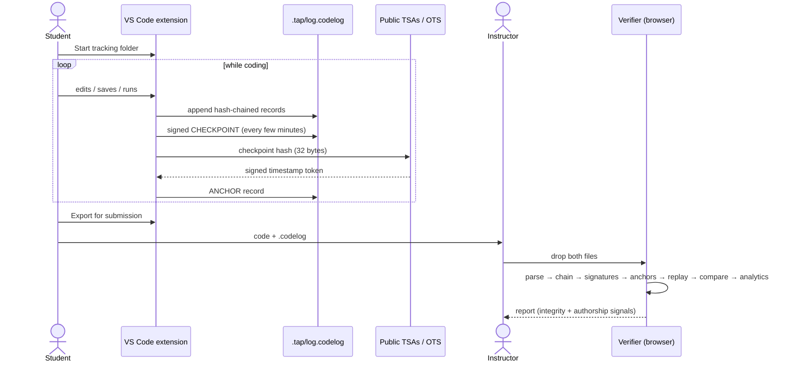
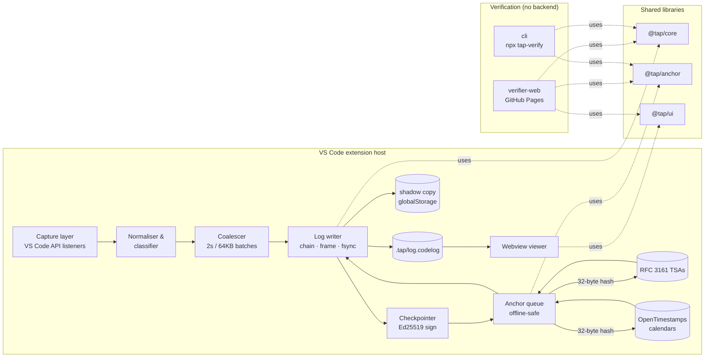
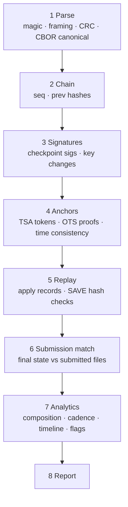

# TAP-CC-ONE — Design Document

> A VS Code extension that records a tamper-evident, independently timestamped history of how code was written. Students attach this history to their submissions so they can counter false plagiarism or AI-use allegations.

| | |
|---|---|
| **Status** | Draft v0.4 (Parts 1–3 implemented) |
| **Recording model** | **Option C: full edit stream** (decided 2026-10-11, see §2.4) |
| **Owner** | Abdullah |
| **Last updated** | 2026-10-13 |
| **First target** | VS Code and compatible editors (Cursor, Windsurf, VSCodium, code-server) on Windows, macOS and Linux |
| **Cost constraint** | $0 running cost: no paid servers or paid services |

> Naming note: "TAP-CC-ONE" is the repository name. The product name, the `.codelog` file extension and the `.tap/` folder name are working names and can change before 1.0. The format spec keeps them in one place, so a rename is cheap.

---

## Table of contents

1. [Summary](#1-summary)
2. [Problem, goals and non-goals](#2-problem-goals-and-non-goals)
3. [Users and core journeys](#3-users-and-core-journeys)
4. [Trust and threat model](#4-trust-and-threat-model)
5. [System architecture](#5-system-architecture)
6. [Event capture](#6-event-capture)
7. [Log format specification (v1)](#7-log-format-specification-v1)
8. [Key management](#8-key-management)
9. [Anchoring subsystem](#9-anchoring-subsystem)
10. [Replay and provenance engine](#10-replay-and-provenance-engine)
11. [Extension design](#11-extension-design)
12. [In-editor viewer](#12-in-editor-viewer)
13. [Verifier (web and CLI)](#13-verifier-web-and-cli)
14. [Privacy and data handling](#14-privacy-and-data-handling)
15. [Technology stack](#15-technology-stack)
16. [Repository layout and tooling](#16-repository-layout-and-tooling)
17. [Testing strategy](#17-testing-strategy)
18. [CI/CD, release and compatibility](#18-cicd-release-and-compatibility)
19. [Roadmap and milestones](#19-roadmap-and-milestones)
20. [Risks and open questions](#20-risks-and-open-questions)
21. [Glossary](#21-glossary)
22. [Decisions made during implementation](#22-decisions-made-during-implementation)
- [Appendix A — CDDL schema](#appendix-a--cddl-schema)
- [Appendix B — Example verification report](#appendix-b--example-verification-report)
- [Appendix C — Test vector catalogue](#appendix-c--test-vector-catalogue)

---

## 1. Summary

A student "connects" a project folder to the extension. From then on, every edit, save, file operation and program run in that folder is appended to a binary log file (`.tap/log.codelog`).

Edits are recorded as **text changes grouped every 2 seconds** ("inserted `for (int i` at position 120", "deleted 3 characters", "pasted 14 lines"). They are not raw key presses: no Shift, arrow keys, cursor moves or selections. The viewer rolls these changes up into a **per-save history**, a local version control the student and teacher read like commits. Any save can be expanded into a **replay** of how that code was written.

The log is:

- **Unreadable as plain text.** It is compressed binary CBOR. You can't open it in Notepad and make sense of it.
- **Readable through the extension.** A read-only viewer ("View" button) decodes it and replays the code being written over time.
- **Tamper-evident.** Every record is linked into a SHA-256 hash chain. Periodic checkpoints are signed with an Ed25519 key.
- **Independently timestamped.** Checkpoint hashes are sent, as hashes only, to free public timestamping services: RFC 3161 TSAs and OpenTimestamps. Their signed receipts prove the log existed no later than a given time.

The student submits the log with their code. The instructor opens a free, static **verifier web page**, drops in both, and gets a report. The report has two parts:

- **Integrity checks.** Cryptographic and binary: chain intact, signatures valid, anchors valid, final replayed state matches the submitted code.
- **Authorship signals.** Interpretive: how much of the final code was typed versus pasted, the timeline, revision behaviour, edit/run cycles. These are for human review only.

There is no backend. The only network traffic is 32-byte hashes going to timestamp services.

### How the original idea maps to this design

| Original requirement | Design element |
|---|---|
| Connect files to an extension | "Start tracking this folder" creates `.tap/` in the workspace (§11.2) |
| Log new code on each save or run | Per-save history is the primary view (§12.1). Underneath it, continuous edit capture records how the code between saves was produced (§2.4, §6) |
| Date and time on every entry | Wall clock plus monotonic clock per record, with independent anchoring (§7.5, §9) |
| Unreadable format, like binary | Framed, compressed, deterministic CBOR (§7.2) |
| View button that makes it readable | Read-only webview viewer with replay (§12) |
| Readable but not editable | The viewer has no edit path, and any edit to the file breaks the hash chain, signatures and anchors (§4, §7) |

---

## 2. Problem, goals and non-goals

### 2.1 Problem

Students are increasingly accused of plagiarism or AI use on programming assignments. The evidence is often weak: similarity scores, AI-detector output, or "this looks too clean". Students usually have no way to show *how* they produced their code. Git history helps only if they committed often, and commit timestamps are trivially editable.

### 2.2 Goals

| ID | Goal |
|---|---|
| G1 | Record the process of writing code at keystroke-batch resolution, with negligible effect on editor performance. |
| G2 | Make the record **tamper-evident**. Any modification, insertion, deletion or reordering of past records is detectable. |
| G3 | Make the record **time-bound by third parties**. The student can't credibly backdate a fabricated log. |
| G4 | Let a non-technical instructor verify a log in under two minutes, with no installation and no account. |
| G5 | Prove that the submitted code is exactly the code the log produces. |
| G6 | Run on Windows, macOS and Linux in VS Code and its forks, published on the VS Code Marketplace and Open VSX. |
| G7 | Zero running cost and no project-operated backend. |
| G8 | Respect privacy. Record only inside tracked folders, send only hashes over the network, and no telemetry. |
| G9 | Keep the format stable and documented, so future JetBrains and Visual Studio ports interoperate through shared test vectors. |

### 2.3 Non-goals

| ID | Non-goal | Why |
|---|---|---|
| N1 | Prove that a human, rather than any tool, typed every character | Not achievable on a machine the student controls. We provide evidence, not proof (§4.5). |
| N2 | Prevent the student from deleting or not submitting the log | The log protects the student, so not submitting it only hurts them. |
| N3 | Detect AI-generated code by analysing its content | That's the unreliable approach this project exists to counter. |
| N4 | Surveillance or proctoring (screen capture, webcam, activity outside the editor) | Invasive, and out of scope. |
| N5 | Confidentiality of the log against the instructor | The student chooses to share it, and the instructor already sees the code. |
| N6 | Replace Git | Complementary. Git is for collaboration; this is for evidence of authorship. |

### 2.4 Decision: recording granularity

Three recording models were considered:

| Option | What's stored | Proves typing vs pasting? | Outcome |
|---|---|---|---|
| **A. Save-only** | One diff plus timestamp per save/run | No | Rejected |
| **B. Save + summary** | Per-save diffs plus per-save counters (typed vs pasted chars, pasted text, active time) | Mostly | Rejected as the final model. Its counters are still derived and shown in C's per-save view |
| **C. Full edit stream** | Every text change, grouped every 2 s, plus saves, runs and file operations | Yes, with replay | **Chosen** |

**Why A fails:**

- An honest student who saves rarely looks guilty. 50 minutes of typing followed by one save looks the same as one paste.
- A cheater can paste a few lines, save, wait and repeat, and the log looks like steady progress.

**Why C over B:** B can show *that* a save was mostly typed, but not *how*. C lets the teacher watch the student hit a segfault, fix it and rewrite a function. A believable human story like that is far harder to fake than counters, and it's the strongest evidence in a misconduct hearing. C also contains everything B shows, because B's counters can be computed from C's data.

### 2.5 Worked example: a 4-hour DSA assignment

Task: 5 medium LeetCode-style problems plus a `Vector` implementation in C++, over 4 hours. These figures are design estimates, to be confirmed by the M2 benchmark (§17.5).

| Item | Estimate |
|---|---|
| Files | 5 solution files, `vector.h`, `main.cpp` (tests) |
| Final code | ~450 lines, ~13,000 characters |
| Characters written in total (including rewrites) | ~2.5× final, ~33,000 |
| Saves / runs | ~120 / ~60 |
| Recorded changes | ~35,000 tuples in ~2,500 `EDIT_BATCH` records |
| Log size, edits and snapshots | ~120–200 KB compressed |
| Log size, timestamp anchors | ~50–100 KB |
| **Total** | **~0.2–0.3 MB** |
| Editor overhead | Within the §11.9 budgets; not noticeable |

What the teacher can tell apart with C:

| Scenario | How it appears |
|---|---|
| Honest student who saves rarely | One `+220 lines` save of `vector.h`, but 47 active minutes, 97% typed, thousands of deletions, and a replay showing the bugs being fixed |
| Student pasting AI code gradually | Every paste is flagged with its text and marked "not found in workspace", however slowly it's dripped in |
| Student copying their own helper between files | Flagged as a paste but labelled `internal-copy` (benign) |
| Student retyping AI code by hand | Weak signals only: near-linear writing, no failed runs, few rewrites (§4.4 A8) |

### 2.6 Success criteria for 1.0

- The recorder adds less than 1 ms p99 latency per keystroke event on a mid-range laptop (§11.9).
- 100% of the test vectors pass in the core library, the extension viewer, the web verifier and the CLI.
- An instructor unfamiliar with the tool reaches a verdict screen from a fresh browser in under 2 minutes in usability testing.
- No crash in the verifier parser across 24 hours of fuzzing.
- Logs recorded on Windows verify against code checked out on Linux, and vice versa.

---

## 3. Users and core journeys

### 3.1 Personas

- **Student (primary).** Writes C, C++, Python, Java, JavaScript and similar in VS Code. Wants protection with zero friction, and doesn't want to learn cryptography.
- **Instructor or TA (secondary).** Receives submissions and is possibly sceptical. Needs a clear, fair report, and won't install anything.
- **Academic integrity panel (tertiary).** Reads a printed or PDF report during a hearing. Needs plain language and explicit statements of what is and isn't proven.

### 3.2 Student journey

1. Install the extension from the Marketplace, Open VSX or Cursor's extension view.
2. Open an assignment folder. A non-modal prompt asks: *"Record authorship history for this folder?"* The options are **Start**, **Not now** and **Never for this folder**.
3. Code normally. The status bar shows `● TAP` (recording), `⏸ TAP` (paused) or `⚠ TAP` (problem). A small badge shows the anchor status.
4. Optionally add notes ("starter code copied from the course page"), which are recorded as NOTE records.
5. Click **View** at any time to see the timeline, replay and integrity status.
6. Before submitting, run **TAP: Export for Submission**. This forces a final checkpoint, waits briefly for anchors, and writes `<folder>-<date>.codelog` next to a short `HOW-TO-VERIFY.txt`.
7. Submit the code plus the `.codelog` file.

### 3.3 Instructor journey

1. Open the verifier URL (a static GitHub Pages site).
2. Drag in the `.codelog` file and the submission (a folder or `.zip`). Nothing is uploaded; everything runs in the browser.
3. Read the report: the integrity checklist, a composition bar for the final code, a timeline, flagged events (each linked to replay) and a replay player.
4. Optionally print or save the report as a PDF for the record.
5. For a whole class, a TA can use the CLI (`npx tap-verify ./submissions`) and get a CSV summary. The CLI also detects duplicate logs or keys across students (§13.6).

### 3.4 Journey diagram



---

## 4. Trust and threat model

The design follows from one fact: **the person producing the evidence controls the machine that produces it.** The student is both the beneficiary and the potential adversary. So the design aims to make honest logs easy, and dishonest logs expensive and visible.

### 4.1 Assets

| Asset | Property we protect |
|---|---|
| Sequence of records | Integrity: no undetected modification, insertion, deletion or reorder |
| Timing of records | Upper bound on creation time, from third-party anchors |
| Final code state | Must equal the submitted code byte for byte (after normalisation, §10.4) |
| Student's code and privacy | Nothing leaves the machine except hashes |

### 4.2 Actors and trust assumptions

| Actor | Trust |
|---|---|
| Honest student | Wants to be believed and will follow the defaults |
| Dishonest student | Full control of their machine, the extension's code, the clock, and the log file |
| Instructor | Honest but sceptical. Not technical. May over-trust heuristics, so the report must prevent that (§13.5) |
| RFC 3161 TSAs | Trusted to sign the correct time. We use several independent ones, so no single one must be trusted |
| OpenTimestamps / Bitcoin | Trust-minimised. Backdating would require rewriting Bitcoin's history |
| Extension publisher | Must publish reproducible builds and release hashes (§18.3) |

### 4.3 What the system can and can't establish

| Claim | Strength | Mechanism |
|---|---|---|
| The log wasn't modified after anchoring | **Strong** | Hash chain plus third-party timestamps |
| The log wasn't modified after creation, with no anchors | **Weak** | Hash chain and signature only. The student holds the key and could rebuild the whole chain |
| Records existed no later than time T | **Strong** | TSA genTime or a Bitcoin block time |
| Records were created no earlier than time T | Not provided | Not useful: writing early isn't misconduct |
| The submitted code equals the final logged state | **Strong** | Deterministic replay plus content hashes |
| Code was produced incrementally over time | **Moderate–strong** | Many anchors spread across the work period, each committing to the growing state |
| A human typed it, rather than a script or a transcription | **Evidence only** | Behavioural signals (§13.4) |
| Who the human was | **Weak** | Installation key continuity, optional key registration (§8.4) |

### 4.4 Attack catalogue

| # | Attack | Detection or mitigation | Residual risk |
|---|---|---|---|
| A1 | Edit or delete past records in the file | Hash chain breaks, so the verifier pinpoints the first bad record | None |
| A2 | Rebuild the entire chain after editing (student holds the key) | Anchors commit to old checkpoint hashes. A rebuilt chain no longer matches the TSA tokens | Only possible before the first anchor. Minimised by anchoring early and often |
| A3 | Fabricate a complete log later and backdate the timestamps | Anchor times reveal when the log really existed. Wall-clock vs genTime consistency check (§9.6) | None if anchors exist. Unanchored logs are labelled "times unverified" |
| A4 | Paste AI or copied code | Clipboard-match classification marks it as PASTE. Final-code composition shows the pasted percentage | None. Transparent by design |
| A5 | Accept AI inline completions (Copilot, etc.) | Classified as BULK_INSERT (non-clipboard multi-char insertion). AI extensions present and enabled are disclosed in SESSION_START | Small completions resemble IntelliSense |
| A6 | Edit files outside VS Code (another editor, a script, `git checkout`) | FileSystemWatcher → EXTERNAL_CHANGE with a full snapshot. Shadow self-check on save (§6.6) | None |
| A7 | Script that "types" AI code into VS Code at human speed in real time | Cadence uniformity, linearity, no compile/run/fix loop, few revisions (§13.4) | **Real risk.** Evidence-level only |
| A8 | Retype AI output by hand from another screen | Linearity, few revisions and no exploratory runs are signals, but they're weak | **Not reliably detectable.** Stated honestly in the report |
| A9 | Modify the extension to emit fake events | Extension version is recorded. Behavioural analysis doesn't trust client labels. Anchoring constrains timing | Determined attackers can do this. Same class as A7 |
| A10 | Submit a friend's log along with the friend's code | Key fingerprint, logId and anchors duplicate across the class (§13.6). Optional key registration (§8.4) | Requires batch verification or registration |
| A11 | Splice segments from two logs | The chain links every record to its predecessor, and logId is in the genesis hash | None |
| A12 | Manipulate the system clock | Monotonic vs wall-clock divergence → CLOCK_ANOMALY. Anchors bound the true time | None for anchored spans |
| A13 | Truncate the log tail to hide later activity | Removes only evidence, so it hurts the student. The final state must still match the submission | N/A |
| A14 | Pause tracking during misconduct | PAUSE/RESUME are recorded. Changes made during the pause appear as a snapshot with origin `paused-gap` | None. Transparent |
| A15 | Disable anchoring (go offline) | Report shows "N% of records anchored", and unanchored spans are highlighted | Policy decision for the instructor |
| A16 | Malformed log crafted to crash or exploit the verifier | Strict bounded parser, fuzzing, no `eval`, size limits, CSP on web pages (§13.7) | Low |

### 4.5 Design principles from the threat model

1. **Anchor early, anchor often.** Anchoring is what turns a self-asserted log into evidence.
2. **Measure the final code, not the activity.** "38% of the submitted code arrived by paste" matters more than "12% of keystrokes were pastes" (§10.3).
3. **Separate integrity from interpretation.** Integrity checks are pass/fail. Authorship signals are never presented as verdicts.
4. **Be transparent rather than covert.** Everything recorded is visible to the student in the viewer. Pauses, pastes and external changes are labelled, not hidden. A student who knows what's recorded and still passes is more credible.
5. **Don't penalise atypical humans.** Dictation, screen-reader users, non-native keyboard layouts and slow typists all produce unusual cadence. Heuristic thresholds are conservative and documented (§13.5).

---

## 5. System architecture

### 5.1 Components

| Component | Runs in | Responsibility |
|---|---|---|
| `@tap/core` | Node and browser | Format encode/decode, hash chain, signatures, replay, provenance, analytics, verification pipeline |
| `@tap/anchor` | Node and browser (fetch) | RFC 3161 request/response, OpenTimestamps submit/upgrade, token verification |
| `@tap/ui` | Webview and browser | Shared Preact components: timeline, replay player, report, integrity checklist |
| `extension` | VS Code extension host | Capture, coalesce, write, sign, anchor scheduling, viewer host, commands |
| `verifier-web` | Static site (GitHub Pages) | Drag-and-drop verification and printable report |
| `cli` | Node (`npx`) | Batch verification, CSV/JSON output, duplicate detection |

### 5.2 Architecture diagram



### 5.3 Key architectural decisions

| Decision | Choice | Rationale |
|---|---|---|
| Backend | **None** | $0 cost (G7), no data custody, nothing to keep running |
| Shared logic | One isomorphic TypeScript core | The recorder and the verifier can never disagree on the format |
| Crypto libraries | `@noble/*` (pure JS) instead of `node:crypto`/WebCrypto | Identical synchronous API in Node and browsers, audited, no native modules (cross-OS) |
| Serialisation | Deterministic CBOR (RFC 8949 §4.2) | Compact, binary, deterministic for hashing, schema-describable (CDDL) |
| Granularity | Edit batches, not saves only | Save-only logs can't tell typing from pasting (§4.4 A4) |
| Encryption | **None** (compression and binary framing only) | Encryption with a local key adds no security against the key holder and makes verification harder. "Unreadable" is met by the binary format; "non-editable" by tamper-evidence |
| Storage location | Inside the workspace (`.tap/`) plus a shadow copy | Travels with the project and is easy to find and submit. The shadow copy protects against `git clean` and accidental deletion |

---

## 6. Event capture

### 6.1 What is recorded

| Event | VS Code API | Record kind |
|---|---|---|
| Text edits in tracked files | `workspace.onDidChangeTextDocument` | `EDIT_BATCH` |
| Undo/redo | `TextDocumentChangeEvent.reason` | flag on change |
| File opened or first seen | `workspace.onDidOpenTextDocument`, initial scan | `FILE_SNAPSHOT` (origin `preexisting`) |
| Save | `workspace.onWillSaveTextDocument`, `onDidSaveTextDocument` | `SAVE` (+ format-on-save flagging) |
| Create / delete / rename via the editor | `workspace.onDidCreateFiles`, `onDidDeleteFiles`, `onDidRenameFiles` | `FILE_OP` |
| Changes on disk from outside the editor | `workspace.createFileSystemWatcher` + content comparison | `EXTERNAL_CHANGE` (+ snapshot) |
| Debug session start/end | `debug.onDidStartDebugSession`, `onDidTerminateDebugSession` | `RUN_START` / `RUN_END` |
| Task start/end (build, run) | `tasks.onDidStartTaskProcess`, `onDidEndTaskProcess` (exit code) | `RUN_START` / `RUN_END` |
| Terminal commands (e.g. `python main.py`, `g++ a.cpp`) | `window.onDidStartTerminalShellExecution`, `onDidEndTerminalShellExecution` (shell integration, VS Code ≥ 1.93) | `RUN_START` / `RUN_END` (command line optional, §14) |
| Window focus | `window.onDidChangeWindowState` | `FOCUS` (setting, default on) |
| Environment | `extensions.all`, `vscode.version`, `process.platform` | `SESSION_START`, `ENV_CHANGE` |
| Student notes | Command `TAP: Add Note` | `NOTE` |
| Pause/resume | Commands | `PAUSE` / `RESUME` |

**Not recorded:** individual key presses (Shift, Ctrl, arrows, Backspace as a key), cursor position, selections, scrolling, mouse activity, hover or IntelliSense popups that weren't accepted, and anything outside tracked files. Only changes to file text, and the events above, are stored.

### 6.2 Tracking scope

- **Root:** each workspace folder that the student explicitly starts tracking (§11.2). Multi-root workspaces get one log per tracked folder.
- **Include (default):** `**/*.{c,h,cpp,cc,cxx,hpp,hh,py,ipynb*,java,kt,js,jsx,ts,tsx,cs,go,rs,rb,php,swift,m,sql,html,css,scss,sh,ps1,r,jl,hs,ml,scala,lua,dart,asm,s,vhdl,v,sv,md,txt,json,yaml,yml,toml,xml,makefile,cmake,Makefile,CMakeLists.txt}`. (`*.ipynb` is v2; see §6.8.)
- **Exclude (default):** `**/{.git,.tap,node_modules,.venv,venv,__pycache__,build,dist,out,target,bin,obj,.idea,.vscode-test}/**`, plus binary files (NUL byte in the first 8 KB) and files larger than `tap.maxFileSizeKB` (default 1024).
- Both lists are configurable in `.tap/config.json`, so the configuration itself is recorded and visible to the verifier.

### 6.3 Change classification

Each content change gets a flags bitfield (§7.6.4). The algorithm runs in the change handler, with clipboard access deferred:

```
for each event e in onDidChangeTextDocument (tracked doc):
    if e.reason == Undo: flag UNDO
    if e.reason == Redo: flag REDO
    if within onWillSave window for e.document: flag FORMAT_ON_SAVE
    if e.contentChanges.length > 1 and all inserted texts equal: flag MULTI_CURSOR
    for each change c (ordered by descending rangeOffset, see 6.4):
        ins = c.text
        if len(ins) >= tap.classify.clipboardCheckMinChars (default 2)
           and not UNDO/REDO/FORMAT:
            schedule clipboard comparison (async, see below)
        if len(ins) >= tap.classify.bulkMinChars (default 40) or ins contains '\n' with len >= 20:
            provisional flag BULK
```

**Clipboard comparison.** `vscode.env.clipboard.readText()` is async. The handler records the change immediately with provisional flags and queues a comparison. When it resolves, before the batch is flushed, the classification is finalised:

- If `normalizeEol(clipboard) == normalizeEol(ins)`, or the clipboard contains `ins` when a multi-cursor paste splits lines, set `PASTE` and clear `BULK`.
- Otherwise keep `BULK` if it was set. That covers AI inline completions, snippets, drag-and-drop and large autocompletes.
- **The clipboard content is never stored.** Only the boolean result is. The inserted text is stored anyway, because it is the edit.

Batches wait at most 250 ms for pending clipboard checks. A timeout leaves the provisional flags and sets `CLASSIFY_TIMEOUT`.

**Paste source (done in the verifier, not the recorder).** For each PASTE, the verifier searches the replayed workspace state at that moment for the pasted text. If found, it relabels the paste as `internal-copy`: moving your own code around is normal refactoring, not misconduct.

### 6.4 Ordering semantics for multi-change events

VS Code reports all `contentChanges` of one event relative to the document *before* the event. The recorder converts them to **sequential application semantics**: changes are sorted by `rangeOffset` descending, so applying them one after another in stored order gives the same result. The first change carries the real `dt`, and the rest carry `dt = 0`. The shadow self-check (§6.6) proves this conversion correct at runtime.

### 6.5 Coalescing and flushing

Keystrokes are buffered in memory per file and written as `EDIT_BATCH` records. A flush happens on the **first** of:

- 2 s since the first unflushed change
- 64 KB of buffered text
- a save, run start, focus loss, pause, checkpoint or command
- extension deactivation (synchronous final flush, §11.7)

Each change stores `dt`, the milliseconds since the previous change in the same file (monotonic clock). This keeps per-keystroke timing for cadence analysis at about 1–2 bytes per change.

### 6.6 Shadow self-check

The recorder keeps an in-memory **shadow text** per tracked file. It is seeded from the snapshot, and every recorded change is applied to it with the same replay function the verifier uses. On every save and every checkpoint:

```
if sha256(normalize(shadow[f])) != sha256(normalize(document.getText())):
    write FILE_SNAPSHOT(origin = "resync", text = document.getText())
    shadow[f] = document.getText()
    increment resync counter (shown in viewer & report)
```

This catches API ordering surprises, extension bugs and missed events. Gaps are recorded honestly instead of producing a log that fails replay.

### 6.7 External changes

The FileSystemWatcher fires for changes the editor itself made (saves) as well. To tell them apart, the recorder keeps the content hash of its last known on-disk state per file (updated after every SAVE). On a watcher event it reads the file, hashes it and compares:

- **Equal to the last saved hash:** ignore (our own save).
- **Different:** `EXTERNAL_CHANGE { f, h }` followed by `FILE_SNAPSHOT(origin = "external")` carrying the full new text.
- If `.git/HEAD` or `.git/index` changed within 2 s, add the hint `vcs` (branch switch, pull, stash).
- **New untracked file appearing:** `FILE_OP(create, origin = external)` plus a snapshot.

### 6.8 Edge cases

| Case | Handling |
|---|---|
| Untitled buffers saved into the workspace | Track untitled documents in memory. When a tracked file is created whose content hash equals an untitled buffer's shadow, emit `FILE_OP(create, fromUntitled)`, which makes its edit history part of the file's provenance |
| Jupyter notebooks (`.ipynb`) | **v2.** Cell text documents use the `vscode-notebook-cell` scheme. Map edits to `(notebookPath, cellId)`. v1 tracks `.ipynb` only as external snapshots on save |
| Live Share / collaborative editing | Remote participants' edits look like local edits. Disclose `liveShareActive` in SESSION_START/ENV_CHANGE |
| Remote (WSL, SSH, Dev Containers, Codespaces) | `extensionKind: ["workspace"]`, so the recorder runs next to the files. The clipboard API is proxied by VS Code and still works |
| Huge paste (> 256 KB) | Stored in full (it's evidence), and flagged `LARGE` |
| File encoding is not UTF-8 | Record `enc` in the snapshot from `TextDocument.encoding` when available, else `utf8`. Hashes use the document text normalised per §10.4 |
| Two VS Code windows on the same folder | Lock file (§11.6). The second window is read-only and shows a notice |
| Auto-save after delay | Produces many SAVE records. Fine: they're cheap (~50 bytes) |
| Formatter on save | Edits during the will-save window get `FORMAT_ON_SAVE` and are excluded from the "typed" share but shown separately |
| System sleep/hibernate | The monotonic clock may pause. The gap is visible in wall time. The next record gets `CLOCK_ANOMALY` only if the drift isn't explainable by sleep (wall jump with no events and focus lost) |

---

## 7. Log format specification (v1)

> The format is the contract between all current and future implementations. It's frozen at 1.0. Changes after that bump `fmt` and stay readable forever (§18.4).

### 7.1 Design requirements

- Append-only, with crash-safe writes.
- Deterministic bytes for anything that's hashed.
- Compact: typical assignment logs under 2 MB.
- Self-describing and versioned.
- Streamable: the verifier can process large logs without loading them into memory twice.
- Detect corruption from line-ending conversion and text-mode transfers.

### 7.2 File layout

```
+--------------------------------------------------------------+
| MAGIC (8 bytes)  0x89 'C' 'L' 'G' 0x0D 0x0A 0x1A 0x0A        |
+--------------------------------------------------------------+
| HEADER BLOCK  (framed, codec = none)                         |
+--------------------------------------------------------------+
| BLOCK 1 (framed)                                             |
| BLOCK 2 (framed)                                             |
| ...                                                          |
+--------------------------------------------------------------+
```

The magic bytes follow the PNG convention. The high-bit first byte catches 7-bit transfers. The CR LF pair catches line-ending conversion, and 0x1A stops `type` on Windows. Any of those corruptions makes the file fail fast with a clear error.

### 7.3 Block framing

```
offset  size  field
0       4     payload_len   u32 big-endian (bytes of payload as stored)
4       1     codec         0 = none, 1 = deflate-raw
5       4     raw_len       u32 big-endian (payload length after decompression)
9       n     payload
9+n     4     crc32         CRC-32/ISO-HDLC over bytes [0 .. 9+n)
```

- **Limits:** `raw_len ≤ 8 MiB` and `payload_len ≤ raw_len + 1 KiB`. The verifier rejects anything larger *before* allocating. (Raised from 1 MiB during implementation; see §22.1.)
- **Decompressed payload:** a CBOR sequence (RFC 8742) of one or more records.
- CRC protects against storage corruption. Integrity against tampering comes from the hash chain, not the CRC.

### 7.4 Header

The header block contains exactly one CBOR map:

```
{
  "fmt":     1,                       ; format version
  "logId":   h'…16 bytes…',           ; random, CSPRNG
  "created": 1760169600000,           ; unix ms, UTC
  "tool":    "tap-cc-one/0.1.0",      ; recorder name/version
  "hash":    "sha-256",
  "sig":     "ed25519",
  "label":   "assignment-3"           ; student-editable workspace label
}
```

The header is never rewritten after creation.

### 7.5 Record envelope

Every record is a CBOR map with these fields:

| Key | Type | Meaning |
|---|---|---|
| `s` | uint | Sequence number, starting at 0, strictly +1 |
| `k` | uint | Record kind (§7.6) |
| `t` | uint | Wall-clock time, unix ms UTC (self-asserted) |
| `m` | uint | Monotonic ms since this record's SESSION_START (from `performance.now()`) |
| `p` | bstr(32) | Hash of the previous record (or the genesis hash for `s = 0`) |
| `b` | map | Kind-specific body |

### 7.6 Record kinds

| Code | Kind | Body fields (summary) |
|---|---|---|
| 1 | `SESSION_START` | `sid` (bstr16), `pub` (bstr32 Ed25519 pubkey), `vsc` (VS Code version), `app` (`vscode`/`cursor`/`vscodium`/…), `os` (`win32`/`darwin`/`linux`), `ext` (recorder version), `aiExt` (array of enabled AI-assist extension IDs), `liveShare` (bool), `cfgHash` (hash of `.tap/config.json`) |
| 2 | `SESSION_END` | `sid`, `reason` (`close`/`reload`/`deactivate`) |
| 3 | `FILE_SNAPSHOT` | `f` (file id), `path` (workspace-relative, `/`), `origin` (`preexisting`/`created`/`external`/`resync`/`paused-gap`/`periodic`), `text`, `h`, `eol` (`lf`/`crlf`), `enc` |
| 4 | `EDIT_BATCH` | `f`, `c`: array of changes `[dt, off, del, ins, flags]` |
| 5 | `SAVE` | `f`, `h` (hash of normalised content), `n` (UTF-16 length) |
| 6 | `FILE_OP` | `op` (`create`/`delete`/`rename`), `f`, `path`, `newPath?`, `origin` (`editor`/`external`/`fromUntitled`) |
| 7 | `EXTERNAL_CHANGE` | `f`, `h`, `hint?` (`vcs`) |
| 8 | `RUN_START` | `rid`, `kind` (`debug`/`task`/`terminal`), `name?`, `cmd?` (if enabled), `cwd?` (relative) |
| 9 | `RUN_END` | `rid`, `exit?` (int) |
| 10 | `FOCUS` | `on` (bool) |
| 11 | `PAUSE` | `why?` (free text, optional) |
| 12 | `RESUME` | (none) |
| 13 | `CHECKPOINT` | `state` (bstr32 state digest), `files` (uint count), `sig` (bstr64) |
| 14 | `ANCHOR` | `ck` (seq of the checkpoint), `d` (bstr32 anchored digest), `type` (`rfc3161`/`ots`), `src` (URL), `tok` (bstr), `status` (`complete`/`pending`/`upgraded`) |
| 15 | `RECOVERY` | `lostBytes`, `quarantineHash`, `atOffset` |
| 16 | `NOTE` | `text` (≤ 2000 chars) |
| 17 | `KEY_ROTATION` | `oldPub?`, `newPub`, `why` (`lost`/`manual`) |
| 18 | `CLOCK_ANOMALY` | `wallDelta`, `monoDelta` |
| 19 | `ENV_CHANGE` | changed subset of the SESSION_START environment fields |

#### 7.6.1 File ids

`f` is a small uint assigned the first time a path appears in a log (via `FILE_SNAPSHOT` or `FILE_OP create`). Renames keep the id. Ids are never reused within a log.

#### 7.6.2 Change tuple

`[dt, off, del, ins, flags]`:

- `dt`: uint, ms since the previous change to this file (monotonic). Capped at 2^32−1.
- `off`: uint, offset in **UTF-16 code units** into the file text as it is *at the moment of applying* (sequential semantics, §6.4). It matches VS Code's `rangeOffset`. JetBrains (Java strings) also uses UTF-16, so ports stay compatible.
- `del`: uint, number of UTF-16 code units deleted starting at `off`.
- `ins`: tstr, the inserted text, which can be empty.
- `flags`: uint bitfield (omitted when 0, so the tuple has 4 elements).

#### 7.6.3 Offsets are in document-native EOL

Offsets and lengths refer to the document's actual text, including `\r\n` when the file uses CRLF. Normalisation happens only when hashing for comparison (§10.4), never during replay.

#### 7.6.4 Change flags

| Bit | Name | Meaning |
|---|---|---|
| 0x01 | `UNDO` | Change came from undo |
| 0x02 | `REDO` | Change came from redo |
| 0x04 | `PASTE` | Inserted text equals the clipboard |
| 0x08 | `BULK` | Multi-char insertion, not a paste (completion, snippet, AI, drop) |
| 0x10 | `MULTI_CURSOR` | Part of a multi-cursor edit |
| 0x20 | `FORMAT_ON_SAVE` | Made by a formatter during save |
| 0x40 | `LARGE` | Inserted text > 256 KB |
| 0x80 | `CLASSIFY_TIMEOUT` | Clipboard check didn't complete in time |

### 7.7 Canonical encoding

Every record is encoded with **deterministic CBOR** (RFC 8949 §4.2.1):

- Shortest-form integers and lengths. No indefinite lengths.
- Map keys sorted by the bytewise order of their encodings.
- No floating point anywhere in the format.
- Text strings must be valid UTF-8 (lone surrogates in the editor are encoded as U+FFFD, and the change gets a `RESYNC` follow-up if that alters the text).
- Absent optional fields are **omitted**, never encoded as `null`.

Decoders **reject** non-canonical input. That prevents two different byte strings from representing the "same" record (malleability).

### 7.8 Hashing and the chain

```
DS(x) = UTF-8 bytes of x followed by 0x00   ; domain separation

genesis   = SHA-256( DS("CLG1/genesis") || canonical(header) )
H(rec)    = SHA-256( DS("CLG1/record")  || canonical(rec) )   ; rec includes p
rec[0].p  = genesis
rec[i].p  = H(rec[i-1])
```

Verification walks records in order, checks `s` increments by exactly 1, recomputes `H`, and checks every `p`. The first mismatch is reported with its sequence number and block offset.

### 7.9 State digest

```
entries  = sorted by path: [ path, f, sha256(normalize(text_f)) ] for every live file
state    = SHA-256( DS("CLG1/state") || canonical(entries) )
```

Because the checkpoint commits to the *state* as well as the chain, an anchor proves "this exact code existed by time T". That makes incremental-progress claims (§4.3) cheap to verify, without replaying.

### 7.10 Checkpoints and signatures

A `CHECKPOINT` is written:

- every 5 minutes of active recording (setting `tap.checkpoint.intervalSec`, default 300)
- on SESSION_END, on Export, and before any PAUSE

```
msg = DS("CLG1/checkpoint") || logId || u64be(s) || p || state || u64be(t)
sig = Ed25519.sign(sk, msg)
```

The checkpoint record itself is chained like any other record. Its hash, `H(checkpoint)`, is the value that gets anchored.

### 7.11 Anchors

See §9. An `ANCHOR` record refers to a previous checkpoint by `ck` (its `s`) and carries `d = H(checkpoint)`. Anchor records arrive later in the chain than the checkpoint they anchor, because network round trips take time.

### 7.12 Crash recovery

On opening a log for append:

1. Validate the magic and header.
2. Scan blocks sequentially, checking framing, CRC and decompression.
3. At the first invalid or truncated block, copy the bytes from that offset to EOF into `.tap/quarantine/<timestamp>.bin`, truncate the file at that offset, and `fsync`.
4. Rebuild the chain head from the last valid record and append `RECOVERY { lostBytes, quarantineHash, atOffset }`.

Writes use `fs.appendFile` plus `fsync` per block on the main log, and the same on the shadow copy. A partially written final block is the only expected corruption after a power loss.

### 7.13 Size estimate

| Item | Estimate |
|---|---|
| Change tuple (typing) | ~8–12 bytes raw |
| 3 h active typing at 5 changes/s | ~54k changes → ~550 KB raw → **~180–250 KB compressed** |
| Snapshots (starter code, external changes) | Size of the files, compressed |
| Checkpoint | ~150 bytes |
| RFC 3161 token (with cert) | ~3–6 KB each. Two TSAs every 10 min over 3 h → ~150 KB |
| **Typical assignment** | **0.3–2 MB** |
| Worked example: 4 h, 5 DSA problems plus a `Vector` class (§2.5) | ~0.2–0.3 MB |

TSA tokens dominate. Mitigations: `certReq` is true only for the first token from each TSA per log (later tokens reference the cached certificate), and anchoring is skipped when nothing changed since the last anchor.

---

## 8. Key management

### 8.1 Key generation and storage

- One Ed25519 key pair per OS user per machine, created on first use with `@noble/curves`.
- The private key is stored in `context.secrets` (VS Code SecretStorage). That uses the OS keychain: Windows Credential Manager, macOS Keychain, or libsecret on Linux.
- **Linux fallback:** if no secret service is available (headless or minimal desktops), store the key in `globalStorageUri/key.bin` with `0600` permissions and show a one-time notice.
- The public key goes in every `SESSION_START`.

### 8.2 Fingerprint

`fingerprint = base32(SHA-256(pub))[0..20]`, displayed in groups of four (e.g. `K7QH-3MZD-PX2A-9WTR-F4NB`). It's shown in the viewer, the report and through `TAP: Show Key Fingerprint`.

### 8.3 What the signature does and does not prove

It **does**:

- link all logs from the same installation (continuity over a semester)
- detect modification by third parties who don't have the key
- enable optional instructor registration (§8.4)

It **does not** prove identity, or prevent the key holder from re-signing a rebuilt chain. Anchoring covers that (§4.4 A2). The report explains this in plain language.

### 8.4 Optional key registration (v1.1)

At the start of a course, students submit their fingerprint through the course's normal channel (LMS quiz, form). The verifier accepts a CSV of `studentId,fingerprint` and marks logs signed by an unexpected key. No server is needed.

### 8.5 Rotation and loss

If the key is lost (OS reinstall, keychain reset), a new key is generated and `KEY_ROTATION { newPub, why: "lost" }` is appended. It's signed by the new key only. The verifier shows the key change on the timeline as a warning, which is understandable and not a failure.

---

## 9. Anchoring subsystem

### 9.1 Why both mechanisms

| | RFC 3161 TSA | OpenTimestamps |
|---|---|---|
| Latency | Instant (≈ 0.3–2 s) | Pending immediately; confirmed after the next Bitcoin block aggregation (~hours) |
| Trust | Trust the TSA's signing key and clock | Trust-minimised (Bitcoin proof of work) |
| Verification | Offline, with the bundled TSA root certificates | Needs a Bitcoin block header (fetched from a public API, or a local node) |
| Cost | Free public services | Free public calendars |

RFC 3161 gives instant, easy-to-verify receipts. OpenTimestamps gives long-term proof that doesn't depend on any company.

### 9.2 Default endpoints (configurable)

| Type | Endpoint |
|---|---|
| RFC 3161 | `https://freetsa.org/tsr` |
| RFC 3161 | `http://timestamp.digicert.com` |
| RFC 3161 | `http://timestamp.sectigo.com` |
| OTS calendar | `https://a.pool.opentimestamps.org` |
| OTS calendar | `https://b.pool.opentimestamps.org` |
| OTS calendar | `https://a.pool.eternitywall.com` |

Each anchoring round uses **two** TSAs (rotating) and **one** OTS calendar. Plain HTTP is fine for TSAs: the response is a signed token whose integrity is checked cryptographically, not through transport security.

> Before 1.0, check each TSA's terms of use for third-party, non-code-signing timestamps and record the result in `docs/anchoring-providers.md`. Keep request volume low (§9.4).

### 9.3 RFC 3161 request

- `TimeStampReq { version 1, messageImprint { sha-256, H(checkpoint) }, nonce (64-bit random), certReq (see §7.13) }`
- `POST` with `Content-Type: application/timestamp-query`
- Response: parse `TimeStampResp`, require `status = granted`, then check that the `TSTInfo.messageImprint` equals the request and that the nonce matches.
- Store the full `TimeStampToken` (CMS SignedData DER) in `ANCHOR.tok`.

### 9.4 Scheduling

- Anchor the newest checkpoint **every 10 minutes while there's activity** (`tap.anchoring.intervalSec`, default 600), plus on SESSION_END and Export.
- No new records since the last anchored checkpoint means no request.
- At typical usage that's at most ~6 rounds per hour per student, about 12 TSA requests per hour.

### 9.5 Offline queue

- The anchor queue lives in `globalStorageUri/anchor-queue.json` and survives restarts.
- Retry uses exponential backoff with jitter: 30 s, then doubling up to 30 min.
- A checkpoint anchored late still gets anchored. The report shows the delay (`genTime − t`). Long delays are labelled "anchored late (offline?)", not failures.

### 9.6 OpenTimestamps flow

1. `POST {calendar}/digest` with the 32-byte digest. The response is a pending timestamp (commitment operations plus a calendar attestation). Store it as `ANCHOR(type=ots, status=pending)`.
2. Later (at the next session start, and on Export), try to upgrade with `GET {calendar}/timestamp/{commitment-hex}`. On success, append `ANCHOR(status=upgraded)` with the complete proof down to a Bitcoin block header attestation. Old pending records stay in the chain; the verifier uses the best one.
3. The verifier checks the proof path and compares the resulting merkle root with the Bitcoin block header. The header comes from a public block explorer API, or the user can paste it in offline mode.

### 9.7 Time consistency checks (verifier)

For each anchored checkpoint *c* with token time *g*:

| Check | Rule | Result |
|---|---|---|
| Not in the future | `c.t ≤ g + 120 s` | Fail → `CLOCK_INCONSISTENT` (wall clock set ahead, or a fabricated time) |
| Reasonable latency | `g − c.t ≤ 15 min` | Over that → info: "anchored late" |
| Monotone | genTimes of successive checkpoints are non-decreasing (allowing TSA skew ≤ 2 s) | Fail → warning |
| Coverage | Share of edit records with an anchored checkpoint after them | Shown as a percentage |
| Per-record bound | `existedBy(record) = min genTime over anchors at checkpoints after the record` | Used in the timeline |

---

## 10. Replay and provenance engine

### 10.1 Replay

```
state: Map<fileId, { path, text: string, eol }>
for rec in records:
  switch rec.k:
    FILE_SNAPSHOT: state[f] = { path, text }                       ; replaces content
    EDIT_BATCH:    for [dt, off, del, ins, fl] in rec.b.c:
                       assert 0 ≤ off ≤ len(text) and off+del ≤ len(text)
                       text = text[0:off] + ins + text[off+del:]
    FILE_OP:       create/delete/rename update state
    SAVE:          assert sha256(normalize(state[f].text)) == rec.b.h   ; else REPLAY_MISMATCH
```

For efficient random access (the replay scrubber), the engine stores a full in-memory copy of every file's text at every `CHECKPOINT` during the first pass. Seeking replays forward from the nearest earlier checkpoint.

### 10.2 Text representation

The text is a JavaScript string (UTF-16), so `off` and `del` map directly. For very large files (> 2 MB) the engine switches to a piece table, so edits stay O(log n).

### 10.3 Provenance (final-code composition)

Next to the text, the engine keeps a span list per file: `[{ len, origin, seq }]`. Origin is one of `typed`, `paste`, `internal-copy`, `bulk`, `format`, `external`, `preexisting`, `undo-redo`, `paused-gap` or `resync`.

- **Insertion:** split the span at `off` and insert `{ len(ins), origin(change), seq }`.
- **Deletion:** remove `del` units across spans.
- **Undo/redo:** gets `undo-redo`, a neutral class. The text reappears, but it was originally produced by an earlier event. (v1.1 improvement: restore the original origin by matching undo stacks.)

At the end, the verifier sums the span lengths per origin **over the submitted files only**, which gives the composition bar: "of the 4,812 characters you submitted, 81% were typed, 9% internal copy, 6% starter code, 4% bulk insert." Whitespace-only spans are counted separately, so indentation from auto-format doesn't inflate the "typed" share.

### 10.4 Normalisation for comparison

Used only when hashing for SAVE/state/submission comparison:

1. Decode as UTF-8 (submitted files). Strip a leading BOM.
2. Remove every run of `\r` directly before `\n` (so `\r\n` and `\r\r\n` become `\n`), then convert remaining lone `\r` to `\n`. (Changed during implementation so the result survives Git's line-ending conversion; see §22.1.)
3. No other changes: no trimming, no Unicode normalisation (that would hide real differences).

---

## 11. Extension design

### 11.1 Activation

```json
"activationEvents": [
  "workspaceContains:.tap/config.json",
  "onStartupFinished"
]
```

`onStartupFinished` is used only for the lightweight "track this folder?" prompt check. Nothing is recorded until the folder is started.

### 11.2 Workspace layout

```
<workspace>/
  .tap/
    config.json          # include/exclude, label, settings snapshot (recorded via cfgHash)
    log.codelog          # the log
    lock                 # {pid, windowId, heartbeat}
    quarantine/          # recovered corrupt tails (if any)
    exports/             # Export for Submission output
    .gitignore           # ignores lock, quarantine/
```

Shadow copy: `globalStorageUri/logs/<logIdHex>.codelog`, mirrored byte for byte after every block write. On open, if the workspace log is missing or shorter than the shadow and its prefix matches, it is restored automatically and a warning is shown (see §22.2).

### 11.3 Module structure

```
extension/src/
  activate.ts               # wiring, disposables
  capture/
    documents.ts            # onDidChange/Open/Save/WillSave
    files.ts                # create/delete/rename + FileSystemWatcher
    runs.ts                 # debug, tasks, terminal shell execution
    focus.ts                # window state
    environment.ts          # AI-extension detection, Live Share, versions
  classify/
    clipboard.ts            # async clipboard comparison queue
    flags.ts
  record/
    coalescer.ts            # per-file buffers, flush policy
    shadow.ts               # shadow texts + self-check
    writer.ts               # chain head, framing, fsync, shadow mirroring
    recovery.ts
    lock.ts
  crypto/
    keystore.ts             # SecretStorage + Linux fallback
    checkpointer.ts
  anchor/
    scheduler.ts
    queue.ts                # persisted, backoff
  ui/
    statusBar.ts
    prompts.ts
    viewerPanel.ts          # webview host, CSP, messaging
  commands.ts
  config.ts
```

### 11.4 Commands

| Command | Title |
|---|---|
| `tap.start` | TAP: Start Recording This Folder |
| `tap.pause` / `tap.resume` | TAP: Pause / Resume Recording |
| `tap.openViewer` | TAP: View Log |
| `tap.export` | TAP: Export for Submission |
| `tap.addNote` | TAP: Add Note to Log |
| `tap.anchorNow` | TAP: Timestamp Now |
| `tap.verifyCurrent` | TAP: Verify Log Integrity |
| `tap.showFingerprint` | TAP: Show Key Fingerprint |
| `tap.openVerifierSite` | TAP: Open Web Verifier |

### 11.5 Settings

| Setting | Default | Notes |
|---|---|---|
| `tap.promptOnOpen` | `true` | Ask to track folders that contain code files |
| `tap.include` / `tap.exclude` | see §6.2 | Copied into `.tap/config.json` at start |
| `tap.maxFileSizeKB` | `1024` | |
| `tap.record.focus` | `true` | |
| `tap.record.terminalCommands` | `true` | Command lines in the tracked folder only. Arguments are recorded as-is, so a note in the UI warns about secrets |
| `tap.classify.clipboardCheckMinChars` | `2` | |
| `tap.classify.bulkMinChars` | `40` | |
| `tap.checkpoint.intervalSec` | `300` | Minimum 60 |
| `tap.anchoring.enabled` | `true` | Turning it off shows a persistent warning in the viewer and report |
| `tap.anchoring.intervalSec` | `600` | Minimum 120 |
| `tap.anchoring.tsaUrls` | §9.2 | |
| `tap.anchoring.otsCalendars` | §9.2 | |
| `tap.anchoring.ots` | `true` | |

Settings that weaken evidence (anchoring disabled, focus not recorded) are written into `SESSION_START`/`ENV_CHANGE`, so the verifier sees them.

### 11.6 Multi-window lock

- `lock` holds `{pid, windowId, heartbeatMs}` and is refreshed every 10 s.
- Another window treats the lock as live if its heartbeat is under 30 s old. That window then becomes **read-only**: the viewer works, recording doesn't, and the status bar says "TAP recording in another window".
- A stale lock is taken over, with a `RECOVERY` record if the log needed repair.

### 11.7 Lifecycle and shutdown

- `deactivate()` flushes synchronously: `fs.writeSync` plus `fsync` of the pending block, followed by `SESSION_END` and a final checkpoint. Network anchoring isn't awaited; the next session's queue handles it.
- A crash or kill without deactivate is handled by recovery (§7.12). The next session starts with a fresh `SESSION_START`.

### 11.8 Status bar states

| Display | Meaning |
|---|---|
| `● TAP` | Recording, latest checkpoint anchored |
| `● TAP ⧗` | Recording, anchors pending (offline or in progress) |
| `⏸ TAP` | Paused |
| `⚠ TAP` | Problem (keystore, write failure, lock conflict). Click for details |
| (hidden) | Folder not tracked |

### 11.9 Performance budget

| Path | Budget | Technique |
|---|---|---|
| Change handler | < 0.2 ms average, < 1 ms p99 | Append a tuple to an array. No hashing, no I/O, no allocation per character |
| Clipboard check | Async, off the hot path | Only for insertions ≥ 2 chars |
| Flush | < 5 ms per block | Deflate via fflate. Async append. One fsync per block |
| Checkpoint | < 20 ms | Hash only files changed since the last checkpoint (cached per-file hashes) |
| Memory | < 50 MB for 100 tracked files | Shadow texts plus buffers |
| Extension load | < 50 ms | esbuild single bundle, lazy-load the webview bundle |

Measure this in CI with a benchmark harness that replays a 50k-change synthetic session (§17.5).

---

## 12. In-editor viewer

The "View" button opens a VS Code webview panel built from `@tap/ui`. It has no write path to the log.

### 12.1 Panels

0. **Save History (default view).** The log presented as local version control: one entry per save or run, per file, newest first. Each entry shows the timestamp, the line diff, the run result, and a summary of how the new code arrived, computed from the edit stream between that save and the previous one. Each entry can be expanded into a replay of just that interval.

   ```
   vector.h
   #12  2026-10-27 12:58:30   SAVE + RUN   (+220 −0)   exit 0
        Since last save: 52 min (active 47 min) · 9,840 edits · 4,100 chars deleted
        How it arrived: typed 97% · pasted 3% (1 paste, 6 lines, internal copy from main.cpp)
        + template <typename T> class Vector {
        + public:
        +     void push_back(const T& v) {
        +         if (size_ == cap_) reserve(cap_ ? cap_ * 2 : 1);
        ...
        [▶ Replay 12:06 → 12:58]   [Show full diff]

   3sum.cpp
   #42  2026-10-27 14:09:40   SAVE + RUN   (+6 −2)    exit 1
        Since last save: 4 min (active 4 min) · 310 edits
        How it arrived: typed 100%
   ```

   Diffs are computed in the viewer from the replayed file states at consecutive saves (line-based Myers diff), so they don't need to be stored. A save with no changes is collapsed into the previous entry.

1. **Integrity header.** Chain ✓, signatures ✓, anchors (n complete / n pending), replay ✓, recoveries and resyncs counters. It runs the same `verify()` pipeline as the web verifier, comparing against the **current workspace files** instead of a submission.
2. **Timeline.** Horizontal time axis by session. Lanes for typing intensity, pastes and bulk inserts (markers), runs (exit code coloured), saves, pauses, external changes, focus, and anchors (tick marks).
3. **Replay player.** File picker, a scrubber over sequence/time, and a read-only CodeMirror 6 view. Inserted text is highlighted by origin. Speeds 1×–64×, or "skip idle".
4. **Composition.** The final-code composition bar per file and in total (§10.3).
5. **Events list.** Filterable (pastes, bulk, external, runs, notes). Click to jump the replay.
6. **About this log.** logId, key fingerprint, recorder versions, environment disclosures, settings that weaken evidence.

### 12.2 Security

- CSP: `default-src 'none'; script-src ${webview.cspSource}; style-src ${webview.cspSource} 'nonce-…'; img-src ${webview.cspSource} data:; font-src ${webview.cspSource}; worker-src blob:;` with no inline scripts. The style nonce lets CodeMirror add its base styles; the parsing worker is created from a `blob:` URL, the only kind webviews allow (see §22.3).
- The extension host reads the log bytes and passes them to the webview with `postMessage` as an `ArrayBuffer`. The webview parses them with `@tap/core`.
- Code text is always rendered as text, never as HTML.

---

## 13. Verifier (web and CLI)

### 13.1 Web verifier

- Static site built with Vite and hosted on GitHub Pages (free). It works offline once loaded, and can be saved as a single HTML file.
- Inputs:
  - `.codelog` file (required)
  - submission: folder (File System Access API or `webkitdirectory` input) or `.zip` (unzipped in the browser with fflate)
  - optional key registry CSV
- No uploads, no analytics, no cookies. The privacy statement is shown on the page.

### 13.2 Verification pipeline



Each stage produces typed findings: `{ stage, severity: pass|info|warn|fail, code, message, seq? }`. A `fail` in stages 1–2 stops the later stages (nothing after a broken chain can be trusted). Failures in stages 3–6 don't stop later stages, but they're shown prominently.

### 13.3 Integrity verdict (binary)

| Verdict | Condition |
|---|---|
| **INTACT** | Stages 1–6 have no `fail` |
| **INTACT WITH WARNINGS** | No `fail`, but warnings (late anchors, key rotation, resyncs, recoveries, unanchored tail) |
| **NOT INTACT** | Any `fail` in stages 1–6. The report says which and where |

### 13.4 Authorship signals (interpretive)

| Signal | Computation | Shown as |
|---|---|---|
| Final-code composition | §10.3 | Stacked bar plus per-file table |
| Active time | Sum of inter-change gaps ≤ 5 min | "6 h 40 min across 9 sessions over 5 days" |
| Work spread | Number of distinct days/sessions, first-to-last span | Timeline |
| Revision ratio | Deleted chars ÷ final chars | Number with a typical-range band |
| Linearity | Share of typed insertions at the end of the file vs. inside it | Number with a typical-range band |
| Edit→run cycles | Count of RUN records interleaved with edits, and non-zero exits followed by edits | "47 runs, 19 failed and were followed by fixes" |
| Cadence | Distribution of `dt` for single-char typed changes. Coefficient of variation; share of bursts | Histogram |
| Large insertions | Every PASTE/BULK above 200 chars with its content, time and paste-source label | Table, with each row linked to replay |
| External changes | All EXTERNAL_CHANGE with diffs | Table |
| Gaps in coverage | Pauses, unanchored spans, untracked submitted files | Table |
| Environment | AI-assist extensions enabled, Live Share | Disclosure list |

### 13.5 Fairness rules for the report

- Signals are labelled **"for human review; not evidence of misconduct on their own"**.
- No single "AI score" or "cheating probability" number. Ever.
- Typical-range bands come from beta data with a wide margin and are documented with their source. Before beta data exists, bands aren't shown at all, only raw values.
- Benign explanations are listed next to each flag (e.g. a large paste → "copied from own earlier file, lecture template, or provided starter code").
- Student NOTE records appear inline, so the student's context is visible.
- An "Accessibility" note says that dictation, assistive tech and unusual input methods change cadence and linearity.

### 13.6 CLI

```
npx tap-verify <log-or-dir> [--submission <dir|zip>] [--registry keys.csv]
               [--format text|json|csv] [--offline]
```

- Batch mode: a directory with one sub-folder per student, each containing a `.codelog` and code.
- **Cross-submission checks:** the same `logId`, the same key fingerprint for different students, or identical anchor tokens → flagged.
- Exit code: 0 if all intact, 1 if any NOT INTACT, 2 on usage error.
- Implemented with `node:util.parseArgs` and no runtime dependencies besides the workspace packages.

### 13.7 Hardening

- Bounded parsing: block size limits (§7.3), at most 10 million records, at most 50k files, a decompression bomb guard (`raw_len` declared and enforced), and a time budget with a progress UI.
- Parsing runs in a Web Worker, so the page stays responsive.
- Strict canonical CBOR decoding (§7.7).
- Fuzzed in CI (§17.4).

---

## 14. Privacy and data handling

| Data | Where it goes | Notes |
|---|---|---|
| Code and edits in tracked folders | Local log only | The student chooses whether to share it |
| Code outside tracked folders | Never recorded | |
| Clipboard | Never stored | Only compared to inserted text |
| Absolute paths, username, hostname | Never recorded | Paths are workspace-relative |
| Terminal command lines | Local log (setting) | Tracked-folder terminals only. A UI hint warns about secrets in arguments |
| Window focus | Local log (setting) | On/off is disclosed |
| Checkpoint hashes (32 bytes) | TSAs and OTS calendars | They learn your IP address and request time, nothing else |
| Telemetry | None | The extension makes no other network requests |

- **Transparency:** the viewer shows everything that's recorded. The first-run prompt links to a plain-language "What is recorded" page.
- **Student control:** pause at any time (recorded), stop tracking, delete `.tap/`.
- **Institutional deployments** (future): document compatibility with consent and data-protection requirements, such as GDPR, for any institution that mandates use.

---

## 15. Technology stack

| Area | Choice | Why |
|---|---|---|
| Language | TypeScript 5.x, `strict: true` | One language across all packages |
| Extension runtime | VS Code API, `engines.vscode: ^1.93.0` | 1.93 adds the terminal shell execution API |
| Bundling | esbuild (extension, CLI), Vite (web, webview UI) | Fast, single-file bundles |
| Monorepo | pnpm workspaces | Strict deps, fast, free |
| CBOR | `cborg` | Pure JS. Deterministic encoding and strict decoding |
| Hashes | `@noble/hashes` (SHA-256) | Pure JS, audited, synchronous, same in Node and browsers |
| Signatures | `@noble/curves` (ed25519) | Same reasons |
| Compression | `fflate` | Pure JS deflate-raw, unzip, CRC-32. Small and fast |
| RFC 3161 / CMS | `asn1js` + `pkijs` | Builds requests, parses and verifies tokens in the browser and Node |
| OpenTimestamps | Minimal in-house client (submit, upgrade, verify proof path) | The official JS library is heavy. The operations needed are a small subset |
| UI | Preact + `@preact/signals` | React-style API at about 4 KB. Good for webviews |
| Code view | CodeMirror 6 (read-only) | Much lighter than Monaco, with good decoration API |
| Charts | uPlot | Tiny, fast time-series |
| Lint/format | Biome | One fast tool for both |
| Unit tests | Vitest + fast-check | Property-based tests for replay and encoding |
| Extension tests | `@vscode/test-cli` + `@vscode/test-electron` | Official harness |
| Web E2E | Playwright | Uses the preinstalled Chromium in CI images |
| CI | GitHub Actions (ubuntu, windows, macos matrix) | Free for public repos |
| Publishing | `@vscode/vsce` (Marketplace), `ovsx` (Open VSX) | Both free |
| Hosting | GitHub Pages | Free static hosting for the verifier and docs |

**No native modules anywhere.** That's what makes the extension work unchanged on every OS and CPU architecture (x64 and arm64), without platform-specific VSIX builds.

---

## 16. Repository layout and tooling

```
TAP-CC-ONE/
├── design.md                     # this document
├── README.md
├── LICENSE                       # open source (see §20 open question)
├── spec/
│   ├── log-format-v1.md          # normative spec (extracted from §7)
│   ├── schema-v1.cddl            # Appendix A
│   └── vectors/                  # golden test vectors (Appendix C)
│       ├── 001-minimal.codelog
│       ├── 001-minimal.expected.json
│       └── ...
├── packages/
│   ├── core/                     # @tap/core
│   │   └── src/{format,chain,crypto,replay,provenance,analytics,verify}/
│   ├── anchor/                   # @tap/anchor
│   │   └── src/{rfc3161,ots,roots}/
│   ├── ui/                       # @tap/ui
│   ├── extension/                # VS Code extension (publisher: tbd)
│   ├── verifier-web/
│   └── cli/                      # tap-verify
├── tools/
│   ├── gen-vectors/              # deterministic vector generator
│   ├── bench/                    # performance harness
│   └── fuzz/
├── docs/                         # user docs → GitHub Pages
└── .github/workflows/
    ├── ci.yml
    ├── release.yml
    └── pages.yml
```

Conventions:

- Conventional Commits and Changesets for versioning.
- `@tap/core` has **no** dependency on the `vscode` module and no Node-only APIs. It's enforced with an ESLint/Biome import rule and a browser build in CI.
- TSA root certificates are kept in `packages/anchor/src/roots/`, with a script to refresh them and a CI job that warns 90 days before any expires.

---

## 17. Testing strategy

### 17.1 Unit tests (`core`, `anchor`)

- Canonical CBOR: round-trip, and rejection of non-canonical inputs (unsorted keys, long-form ints, indefinite lengths, floats).
- Chain: every single-byte mutation of a valid log is detected (exhaustive over small vectors).
- Signatures: wrong key, wrong message, rotated keys.
- RFC 3161: parse recorded real tokens from each TSA (fixtures), tampered tokens, wrong imprint, wrong nonce.
- OTS: recorded pending and complete proofs, plus a tampered path.

### 17.2 Property-based tests

- **Replay equivalence:** generate random edit sequences on random Unicode text (including surrogate pairs and CRLF) and apply them both through a reference model and the encode → decode → replay path. The results must be equal.
- **Multi-change ordering:** generate random non-overlapping change sets in "relative to the original" form, convert them to sequential semantics (§6.4) and confirm they're equivalent.
- **Provenance conservation:** the sum of span lengths always equals the text length.

### 17.3 Extension integration tests

Run inside real VS Code (`@vscode/test-electron`) on all three OSes:

- Typing, multi-cursor, undo/redo, paste (clipboard set programmatically), snippet insertion, format on save
- External modification during a session, and git checkout in the workspace
- Kill the extension host mid-write, reopen, and check that recovery yields a valid log with a RECOVERY record
- Two windows on the same folder (lock behaviour)
- Shadow self-check: inject a missed event and expect a `resync` snapshot

### 17.4 Fuzzing

- A structure-aware fuzzer mutates the framing, CBOR and record fields of valid vectors. The verifier must never crash, hang beyond its budget, or allocate beyond its limits.
- Runs nightly in CI for 30 min, and for 24 h before every release candidate.

### 17.5 Performance

- The `tools/bench` harness drives 50k synthetic changes through the recorder pipeline (without VS Code) and asserts the budgets in §11.9. It fails CI on a regression of more than 20%.

### 17.6 Cross-implementation conformance

- `spec/vectors/` is the shared truth. Every implementation (TS now; Kotlin and C# later) must produce byte-identical encodings for generated vectors and identical verification results (`expected.json`).

### 17.7 Usability testing

- Five or more instructors and TAs who haven't seen the tool before. Task: "Decide whether this submission's log is intact and summarise how the code was produced." Target: under 2 minutes, with no misreading of signals as verdicts.

---

## 18. CI/CD, release and compatibility

### 18.1 Pipelines

| Workflow | Trigger | Steps |
|---|---|---|
| `ci.yml` | PR, push | Install → Biome → typecheck → unit and property tests → build all → extension integration tests (matrix ubuntu/windows/macos) → web E2E → bench |
| `release.yml` | Tag `v*` | Build → test → `vsce package` → `vsce publish` → `ovsx publish` → GitHub Release with the VSIX and its SHA-256 → publish the CLI to npm |
| `pages.yml` | Push to `main` | Build verifier-web and docs → GitHub Pages |
| `fuzz.yml` | Nightly | Fuzz for 30 min. Upload crashes as artifacts |

Secrets needed (all free): `VSCE_PAT` (Azure DevOps personal access token for the Marketplace publisher), `OVSX_PAT` (Open VSX token) and `NPM_TOKEN`.

### 18.2 Versioning

- The extension, CLI and web verifier use SemVer.
- The **format version (`fmt`)** is independent of the tool versions. It changes only when the on-disk format changes.

### 18.3 Reproducible builds

- Lockfile-pinned dependencies, pinned toolchain via `packageManager` and `.nvmrc`, and esbuild with deterministic output.
- The release notes publish the SHA-256 of the VSIX. Anyone can rebuild from the tag and compare. That gives instructors a reason to trust the recorder.

### 18.4 Compatibility policy

- Verifiers can read **all** past format versions, permanently.
- Recorders write only the latest format version.
- Adding optional fields to a record body is a **minor** change: older verifiers must ignore unknown body keys, but **never** unknown record kinds or envelope keys, because those fail closed.
- Before 1.0, `fmt` may change freely. After 1.0, frozen v1 vectors are kept forever.

---

## 19. Roadmap and milestones

| Milestone | Scope | Exit criteria | Est. |
|---|---|---|---|
| **M0 Foundations** | Monorepo, CI matrix, Biome, spec draft (§7), CDDL, first 5 vectors | CI green on 3 OSes. Spec reviewed | 1 wk |
| **M1 Core** | Format writer/reader, canonical CBOR, chain, Ed25519, replay, provenance, state digest | All core unit and property tests pass. Vectors 001–015 | 2 wk |
| **M2 Recorder MVP** | Start/pause, capture (§6.1 except terminal), classification, coalescer, shadow self-check, writer, recovery, lock, keystore, checkpoints, status bar | Integration tests §17.3 pass on 3 OSes. Bench within budget | 2–3 wk |
| **M3 Viewer** | Webview: integrity header, timeline, replay, composition, events | Works on a 3-hour real session log | 2 wk |
| **M4 Anchoring** | RFC 3161 (multi-TSA), offline queue, OTS submit/upgrade, terminal-run capture | Anchors complete. 24 h offline then online drains the queue | 1–2 wk |
| **M5 Verifier** | Web verifier (submission match, analytics, report, print), CLI (batch, CSV, cross-checks) | Usability target §17.7 met with three or more instructors | 2–3 wk |
| **M6 Beta hardening** | Fuzzing, perf, docs, privacy page, "What is recorded" page, TSA terms review, real-user beta (classmates) | No P0/P1 bugs open for 2 weeks | 2–3 wk |
| **M7 Release 1.0** | Freeze `fmt` 1, publish to Marketplace and Open VSX, Pages live | Listed and installable in VS Code, Cursor and VSCodium | — |
| **Post-1.0** | Key registry (v1.1), Jupyter cells, course config (starter-code hashes, deadlines), undo-origin restoration, JetBrains port, Visual Studio port | — | — |

### 19.1 Course config (post-1.0 preview)

The instructor publishes `tap-course.json`, containing the assignment id, the open/due window, **starter-code file hashes** and anchoring requirements. The student drops it into `.tap/`. The verifier then labels starter code as "instructor-provided" (instead of "preexisting"), checks work against the assignment window, and enforces the minimum anchoring policy.

---

## 20. Risks and open questions

### 20.1 Risks

| Risk | Impact | Likelihood | Mitigation |
|---|---|---|---|
| Heuristics misread as proof of cheating, which harms students | High | Medium | §13.5 fairness rules, wording reviews, no scores |
| Public TSA rate limits, outages or policy changes | Medium | Medium | Several TSAs, OTS fallback, configurable endpoints, low request rate, offline queue |
| AI inline completions indistinguishable from IntelliSense at small sizes | Medium | High | Disclose AI extensions in use. Classify BULK by size. Be honest in the report |
| Real-time "typing bot" attack (A7) | Medium | Low–Medium | Cadence and linearity signals. Accept the residual risk and state it |
| Format design flaw found after 1.0 | High | Low | Extensive vectors and fuzzing before freezing. Version-tolerant verifier |
| SecretStorage unavailable on some Linux setups | Low | Medium | File fallback with notice (§8.1) |
| VS Code API behaviour differs in forks (Cursor, Windsurf) | Medium | Medium | CI smoke tests on forks where feasible. Beta testers on each |
| Students forget to start recording | High | Medium | Prompt on open for code folders. Status-bar visibility. Course config (post-1.0) |
| Institutions don't accept the evidence | High | Medium | Open source, reproducible builds, clear spec, plain-language report, early instructor feedback in M5 |
| TSA certificate expiry breaks old-token verification | Medium | Low | Embed the certificates in tokens. Keep historical roots. Verify against genTime validity |

### 20.2 Open questions

1. **Product name** and publisher ID for the Marketplace.
2. **License:** decided: PolyForm Noncommercial 1.0.0 for the code (free for education, research and personal use; commercial use by separate licence), MIT for `spec/` so any tool can read and verify logs.
3. **Defaults for focus and terminal command recording:** on (better evidence) or off (more privacy)?
4. Should **unanchored logs** show a stronger warning by default, or is that institution policy (course config)?
5. **OTS verification source:** which public block-header API to use, plus a fallback for pasting a header manually.
6. When to add **Jupyter support** (many Python courses use notebooks): v1.1 or 1.0?
7. Should **Export** also produce a submission ZIP (code plus log plus HOW-TO-VERIFY), or only the log?
8. Minimum VS Code version: 1.93 for the terminal API, vs. a lower version with terminal capture turned off.

---

## 21. Glossary

| Term | Meaning |
|---|---|
| **Anchor** | Third-party proof that a digest existed by a given time |
| **Checkpoint** | Signed record committing to the chain head and the full file state |
| **Chain head** | Hash of the most recent record |
| **CDDL** | Concise Data Definition Language (RFC 8610), a schema language for CBOR |
| **Deterministic CBOR** | CBOR encoding rules that give a single valid byte string per value |
| **genTime** | Time asserted in an RFC 3161 timestamp token |
| **OTS** | OpenTimestamps: Bitcoin-anchored timestamp proofs |
| **Provenance** | Per-character origin of the final code (typed, pasted, …) |
| **Shadow text** | Recorder's in-memory replay of a file, used for self-checks |
| **State digest** | Hash committing to all live files' paths and content hashes |
| **TSA** | Time Stamping Authority (RFC 3161) |


---

## 22. Decisions made during implementation

Choices made while building, where this document was silent or the plan turned out to need a change. The format-level ones are also in `spec/log-format-v1.md` Appendix A, which is normative.

### 22.1 Part 1 — core format

| Topic | Originally | As built | Why |
|---|---|---|---|
| Maximum block size (§7.3) | 1 MiB | 8 MiB | A tracked file may be up to 1 MiB, and a snapshot of non-ASCII text can take up to 3 bytes per character in UTF-8, so 1 MiB blocks could not hold every legal snapshot. |
| Line-ending normalisation (§10.4) | CRLF and lone CR → LF | A run of CRs before LF is removed, then lone CR → LF | Found by property testing: with single-CR handling, text like `a\r\r\n` hashed differently after Git's CRLF → LF conversion, so an honest submission could fail to match its log. |
| Change flags (§7.6.4) | "omitted when 0" | Omitted when 0, never present as 0; UNDO/REDO and PASTE/BULK mutually exclusive; LARGE set exactly above 256 KiB | Every change has exactly one valid encoding. |
| Header keys (§7.4) | Not specified | Unknown header keys are rejected | Header changes are format changes and bump `fmt`. |
| RECOVERY and KEY_ROTATION (§7.6) | Not specified relative to sessions | Allowed between sessions; RECOVERY closes a session left open by a crash | Matches what a recorder does after a crash or a lost key. |
| Snapshots of known files (§10.3) | Whole file gets the snapshot's origin | Only the region that changed (common prefix/suffix removed) | One line edited outside the editor no longer relabels the whole file. |
| Verdict without anchors (§13.3) | — | Logs without timestamps are INTACT WITH WARNINGS (`NO_ANCHORS`) | Times in an unanchored log are self-asserted, and the report says so. |
| Unprotected tail | — | Records after the last checkpoint can be removed or the very last record changed without breaking the chain | Inherent to hash chains; the recorder writes a checkpoint at every session end, pause and export, so the tail is at most a SESSION_END. |
| Anchor checks in Part 1 | Full token verification | `ck`/`d` consistency only; tokens verified from Part 4 | Part 1 scope. Test vector 102 uses placeholder tokens. |

### 22.2 Part 2 — recorder extension

| Topic | Decision | Why |
|---|---|---|
| Revert File / discarded unsaved edits | Recorded as one EDIT_BATCH change flagged UNDO (from the recorded text back to the saved text), not as an external change | The text was already in the log; treating it as "changed outside the editor" would count against an honest student. Detected because the new text equals the last saved content. |
| Reload of a clean open document | A change event with no undo/redo reason on a clean document (not part of a save) may be the editor reloading the file from disk. It is buffered like an edit and decided before it is written: if the document stays clean for 150 ms it was a reload (EXTERNAL_CHANGE plus an external snapshot); if it becomes dirty it was an edit, unless its text equals the file on disk (a reload immediately followed by typing); a save of the document in the meantime settles it as an edit | VS Code reports reloads as ordinary edits, and it also reports `isDirty = false` with the first edit after a document is opened or saved (the flag is updated a moment later). Found by the integration tests in real VS Code on all three systems: deciding on the reported flag alone recorded first keystrokes and pastes as external changes. |
| Missed file-system events | Closed tracked files are compared with the disk by size and modification time every 60 s and before every verification; pending debounced watcher events are handled immediately before a verification | The watcher can miss events (network drives, WSL, bursts of writes); verification should always see the current files. |
| Unsaved edits discarded by closing a document | Recorded as an UNDO change back to the saved version when the closed file's content equals the last saved version (found by the disk check) | Same reasoning as Revert File. |
| Edits made by save participants (trim whitespace, format on save) | Flagged FORMAT_ON_SAVE when they arrive after VS Code has announced the save to extensions; recorded as ordinary edits otherwise | VS Code does not fix the order of its save participants, so built-in ones may run before extensions hear about the save. Such edits are mostly whitespace, which composition statistics ignore. |
| Unsaved edits restored after a restart (hot exit) | Not treated as an external change when the file on disk still equals the last saved version | The log's newer text was unsaved editor content that comes back when the editor restores the document. |
| Lone UTF-16 surrogates | Stored as U+FFFD (same length, so offsets stay valid); comparisons treat the two forms as equal | Found by randomised testing: a broken half of an emoji (possible through programmatic edits) would otherwise stop recording. |
| File first seen through an edit or a save | FILE_OP create plus a `created` snapshot of its text | The recorder never saw it being written, so the log says so. |
| File created with content through the editor (copy, "save as", template) | `created` snapshot from disk, but only if the user has not already started typing in it | Avoids recording the same text twice. |
| Document opened with text that differs from the log | UNDO change if it equals the last saved version, otherwise a `resync` snapshot | Keeps the log equal to what the editor shows. |
| Missing or truncated `.tap/log.codelog` | Restored from the backup copy automatically, with a warning, when the backup is the same log plus more | Accidental deletion (e.g. `git clean`) should not cost a student their history; restoring never loses data. |
| Pause across window reloads | Remembered; the next session starts with SESSION_START, CHECKPOINT, PAUSE, and changes are reconciled as `paused-gap` on resume | A reload should not silently resume recording. |
| Stop Recording | Ends the session and turns off automatic resume for that folder until "Start Recording" is used again | Otherwise the existing `.tap/` would restart recording on the next window. |
| Second window on the same folder | Lock file with a 10 s heartbeat; a lock is stale after 30 s; the second window stays read-only and says so | Two writers would corrupt the log. |
| Signing key storage | VS Code SecretStorage, checked by reading the key back; falls back to a `0600` file in the extension's storage with a one-time notice; KEY_ROTATION is written automatically when the key differs from the previous session's | Some Linux setups have no working keychain. |
| Terminal commands | Not recorded yet; planned for Part 4 with the terminal shell-integration API | As in `implementationGoals.md`. |
| Disclosure | SESSION_START records the editor name (vscode, cursor, vscodium, windsurf…), enabled AI-assist extensions from a built-in list, Live Share, and the evidence-related settings | Lets a reader see the environment the code was written in. |
| Packaging | The extension package is ESM in source and bundled by esbuild to `dist/extension.cjs`; publisher ID `abdullahforecasts` (can change before publishing) | VS Code loads extensions as CommonJS; keeping sources ESM lets the shared tools load them directly. |
| Testing | Unit tests use a simulated editor and an in-memory stand-in for the VS Code API; tests inside a real VS Code run in CI on Windows, macOS and Linux (VS Code could not be downloaded in the development environment) | Fast local feedback plus real-editor checks. |

### 22.3 Part 3 — viewer

| Topic | Decision | Why |
|---|---|---|
| Replay data | `@tap/core`'s `Replayer` reports every text change with its origin (`onEdit`), including the region a snapshot replaces; the viewer keeps one track of changes per file with a full keyframe every 256 changes. The log format is unchanged | One replay engine for verifier and viewer, so the viewer's origins and composition are exactly the verifier's (tested). Keyframes make any position reachable in a few hundred steps. |
| Time of each change | A change's time is the batch's time minus the `dt` of the changes after it | Records carry the time of the last change in a batch; this restores keystroke timing for playback and active time. |
| Save History entries | One entry per save, per file, newest first; a save with no change since the previous one is folded into it (`SAVE ×2`). A run attaches to the latest save when nothing was edited in between; otherwise it is its own entry. A file's first entry covers the time since it entered the log. Entries show the path the file had when it was saved, with the current name if it was renamed | Matches how students think about their work ("I saved, then ran it") without hiding anything. |
| "How it arrived" | Inserted non-whitespace characters between two saves, by origin (typed, pasted, internal copy with its source file, bulk…) | Simple to explain and to check against the replay; whitespace is excluded as in §10.3. |
| Diffs | Computed in the viewer from the replayed texts at the two saves (Myers line diff, trimmed common prefix/suffix, falls back to "changed region replaced" beyond 4,000 differences) | Nothing extra is stored in the log; the bound keeps a pathological file from freezing the page. |
| Interval replay | "Replay" on a save plays the file from the previous save and stops exactly at that save's content (tested against the SAVE hash for every save, in unit, property and browser tests) | Definition of done for Part 3. |
| Highlighting | Typed text and text that was already there are not highlighted; every other origin is | Highlighting the common case would hide the rare ones that matter. |
| Timeline | Drawn as plain SVG, not with uPlot. Quiet periods longer than 10 minutes become fixed-width breaks | The lanes are markers and ranges, not series; SVG needs no dependency, follows the theme with CSS, and keeps the CSP simple. |
| Parsing off the UI thread | The worker is bundled inline and started from a `blob:` URL; if it cannot start, the viewer parses on the page instead | Webviews only allow `blob:`/`data:` workers. |
| CSP | Adds `worker-src blob:` and a per-load style nonce (CodeMirror inserts a `<style>` element). Scripts are still only the bundled file; no inline script anywhere (tested in Chromium with the same policy) | Keeps §12.2's intent while making the editor component work. |
| Live refresh | While the viewer is visible, every 2 s: write buffered edits to the log (without the disk sweep), send only the bytes appended since last time, and the folder's current files. A log that shrank or was replaced is sent again in full | The log is append-only, so the viewer parses only new blocks (incremental model, tested to equal a full load for any split). |
| Comparing with the folder | The viewer and "TAP: Verify Log Integrity" compare the log with the folder's tracked files as they are now — the editor's text for open documents, the disk otherwise | Unsaved edits are in the log too; comparing with the disk alone would report a false mismatch. |
| Opening speed | Model + verification of the 4-hour benchmark session: about 0.6 s; a 3-hour session opens in the browser in under 1 s. CI fails above 2 s (bench) | Part 3 budget: under 2 s. |
| Build script | The root `pnpm build` filter is quoted (`"./packages/**"`) | Unquoted, the shell expanded the glob and the build silently did nothing on Linux and macOS (found in Part 3). |

---

## Appendix A — CDDL schema

```cddl
; ---------- File ----------
header = {
  fmt: 1,
  logId: bstr .size 16,
  created: uint,
  tool: tstr,
  hash: "sha-256",
  sig: "ed25519",
  ? label: tstr,
}

record = {
  s: uint,
  k: kind,
  t: uint,
  m: uint,
  p: hash32,
  b: body,
}

hash32 = bstr .size 32
fileId = uint
relPath = tstr            ; workspace-relative, '/' separators, no '..'

kind = &(
  SESSION_START: 1, SESSION_END: 2, FILE_SNAPSHOT: 3, EDIT_BATCH: 4,
  SAVE: 5, FILE_OP: 6, EXTERNAL_CHANGE: 7, RUN_START: 8, RUN_END: 9,
  FOCUS: 10, PAUSE: 11, RESUME: 12, CHECKPOINT: 13, ANCHOR: 14,
  RECOVERY: 15, NOTE: 16, KEY_ROTATION: 17, CLOCK_ANOMALY: 18, ENV_CHANGE: 19
)

body = session-start / session-end / file-snapshot / edit-batch / save /
       file-op / external-change / run-start / run-end / focus / pause /
       resume / checkpoint / anchor / recovery / note / key-rotation /
       clock-anomaly / env-change

; ---------- Bodies ----------
session-start = {
  sid: bstr .size 16,
  pub: bstr .size 32,
  vsc: tstr,
  app: tstr,
  os: "win32" / "darwin" / "linux" / tstr,
  ext: tstr,
  aiExt: [* tstr],
  liveShare: bool,
  cfgHash: hash32,
  ? settings: { * tstr => any },   ; evidence-affecting settings snapshot
}
session-end = { sid: bstr .size 16, reason: "close" / "reload" / "deactivate" }

file-snapshot = {
  f: fileId,
  path: relPath,
  origin: "preexisting" / "created" / "external" / "resync" / "paused-gap" / "periodic",
  text: tstr,
  h: hash32,
  eol: "lf" / "crlf",
  enc: tstr,
}

change = [dt: uint, off: uint, del: uint, ins: tstr, ? flags: uint]
edit-batch = { f: fileId, c: [+ change] }

save = { f: fileId, h: hash32, n: uint }

file-op = {
  op: "create" / "delete" / "rename",
  f: fileId,
  path: relPath,
  ? newPath: relPath,
  origin: "editor" / "external" / "fromUntitled",
}

external-change = { f: fileId, h: hash32, ? hint: "vcs" }

run-start = {
  rid: uint,
  kind: "debug" / "task" / "terminal",
  ? name: tstr,
  ? cmd: tstr,
  ? cwd: relPath,
}
run-end = { rid: uint, ? exit: int }

focus  = { on: bool }
pause  = { ? why: tstr }
resume = {}

checkpoint = { state: hash32, files: uint, sig: bstr .size 64 }

anchor = {
  ck: uint,
  d: hash32,
  type: "rfc3161" / "ots",
  src: tstr,
  tok: bstr,
  status: "complete" / "pending" / "upgraded",
}

recovery = { lostBytes: uint, quarantineHash: hash32, atOffset: uint }
note = { text: tstr .size (1..8000) }   ; ≤ 2000 chars, UTF-8 bytes bound
key-rotation = { ? oldPub: bstr .size 32, newPub: bstr .size 32, why: "lost" / "manual" }
clock-anomaly = { wallDelta: int, monoDelta: uint }
env-change = { ? vsc: tstr, ? aiExt: [* tstr], ? liveShare: bool, ? cfgHash: hash32,
               ? settings: { * tstr => any } }
```

---

## Appendix B — Example verification report

```
TAP-CC-ONE Verification Report                     generated 2026-11-02 14:05 (local)
Log: assignment-3-2026-11-01.codelog   logId 9f3a…c21e   key K7QH-3MZD-PX2A-9WTR-F4NB
Recorder: tap-cc-one 1.0.2 · VS Code 1.105.1 · win32

INTEGRITY ............................................. INTACT WITH WARNINGS
  ✓ File structure & encoding valid (412 blocks, 9,861 records)
  ✓ Hash chain intact
  ✓ 74 checkpoint signatures valid (1 key)
  ✓ 71 / 74 checkpoints anchored (RFC 3161: freetsa, digicert; OTS: 66 confirmed)
  ! 3 checkpoints anchored late (offline 2026-10-29 21:10–23:45, max delay 2 h 31 m)
  ✓ Replay consistent with all 318 saves
  ✓ Submitted files match final logged state (6 / 6 files)
  i 1 note from student

TIMING (bounded by third-party timestamps)
  Work period: 2026-10-27 → 2026-11-01 · 9 sessions · active 6 h 40 m
  98.7% of edits anchored within 15 minutes of being written

FINAL CODE COMPOSITION (4,812 non-whitespace characters submitted)
  Typed ................ 81.4%  ███████████████████████████████████████
  Internal copy ........  8.9%  ████
  Starter code .........  5.6%  ██      (preexisting at first recording)
  Bulk insert ..........  2.8%  █       (completions/snippets)
  External paste .......  1.3%  ▌       (1 paste, 63 chars — see event #4411)

PROCESS SIGNALS — for human review; not evidence of misconduct on their own
  Revision ratio 1.9 · 47 runs (19 non-zero exits followed by edits)
  Largest insertions: #4411 paste 63 chars "def read_matrix(path): …" 2026-10-30 19:42
  Environment: AI-assist extensions enabled: none · Live Share: no

STUDENT NOTES
  2026-10-27 16:02  "Starter code main.py and utils.py copied from course page."
```

---

## Appendix C — Test vector catalogue

| # | Vector | Expected |
|---|---|---|
| 001 | Minimal: header, SESSION_START, SESSION_END | Intact |
| 002 | Single file typed, saved, checkpointed | Intact. Composition 100% typed |
| 003 | CRLF file with edits across line endings | Intact. Normalised hashes match LF submission |
| 004 | Surrogate pairs (emoji) inserted and deleted | Intact. Offsets in UTF-16 |
| 005 | Multi-cursor event converted to sequential semantics | Intact |
| 006 | Paste, bulk, format-on-save flags | Composition per flags |
| 007 | Internal copy (paste text exists in workspace) | Labelled internal-copy |
| 008 | External change plus snapshot | Labelled external |
| 009 | Pause / paused-gap snapshot | Gap shown |
| 010 | Rename plus delete plus create | Replay paths correct |
| 011 | Truncated tail plus RECOVERY | Intact with warning |
| 012 | Key rotation | Intact with warning |
| 013 | Checkpoint plus RFC 3161 token (recorded fixture) | Anchor valid |
| 014 | OTS pending and upgraded | Anchor valid (upgraded) |
| 015 | Clock ahead of genTime | CLOCK_INCONSISTENT |
| 100 | Single byte flipped in a middle block | NOT INTACT at the reported seq (CRC) |
| 101 | Record modified and CRC recomputed | NOT INTACT (chain) |
| 102 | Record removed, later `s` renumbered, chain rebuilt, re-signed | NOT INTACT (anchor imprint mismatch) |
| 103 | Non-canonical CBOR (unsorted keys) | Parse failure |
| 104 | Decompression bomb (`raw_len` lies) | Rejected safely |
| 105 | Submission differs from final state by one char | NOT INTACT (submission match) |
| 106 | Two logs with the same logId in a batch | Cross-submission flag |
