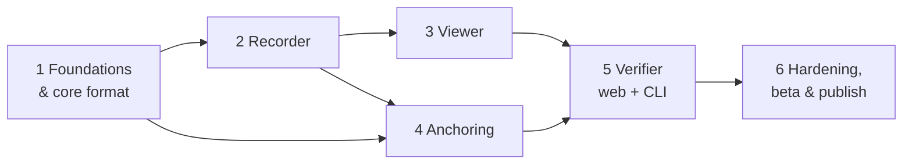

# TAP-CC-ONE — Implementation Goals

> The plan from the first line of code to a published VS Code extension, in six parts. Each part ends with something that works and can be tested on its own. Section references (§) point to `design.md`.

| | |
|---|---|
| **Recording model** | Option C: full edit stream (`design.md` §2.4) |
| **Target** | VS Code, Cursor, Windsurf, VSCodium on Windows, macOS and Linux |
| **Publish to** | VS Code Marketplace and Open VSX |
| **Running cost** | $0 |

## Overview

| Part | Name | Outcome | Est. working time | Calendar |
|---|---|---|---|---|
| 1 | Foundations & core format | Repo, CI, and a core library that writes, reads, chains, signs and replays logs | 5–7 h | Days 1–2 |
| 2 | Recorder extension | The extension records real coding sessions into `.tap/log.codelog` | 5–8 h | Days 2–4 |
| 3 | Viewer: Save History & Replay | The "View" button shows per-save history, replay, timeline and integrity | 4–6 h | Days 4–5 |
| 4 | Timestamp anchoring | Checkpoints are anchored to free public timestamp services, with an offline queue | 3–5 h | Days 5–6 |
| 5 | Verifier (web + CLI) | Teachers verify a log and submission in the browser. TAs batch-verify with the CLI | 5–7 h | Days 6–8 |
| 6 | Hardening, beta & publishing | Fuzzed, benchmarked, beta-tested, and live on both marketplaces | 3–5 h + beta | Weeks 2–5 |

Working time is focused implementation time. Calendar time includes your reviews, testing on Windows and macOS, and beta feedback.

---

## Before Part 1: prerequisites

**Decisions** (from `design.md` §20.2). Defaults are used if left open, and they can still change before Part 6:

| # | Decision | Default if undecided |
|---|---|---|
| 1 | Product name and Marketplace publisher ID | Keep `TAP-CC-ONE` as a working name. Decide before Part 6 |
| 2 | License | MIT |
| 3 | Record focus and terminal commands by default | On (both disclosed in the report) |
| 4 | Jupyter notebook support | After 1.0 |
| 5 | Export also creates a submission ZIP | Yes |
| 6 | Minimum VS Code version | 1.93 |

**Accounts** (all free; only needed by Part 6, but GitHub is needed from Part 1):

- [ ] GitHub repository for `TAP-CC-ONE` (public, so CI and Pages are free)
- [ ] Node.js 20+ and pnpm installed locally
- [ ] VS Code installed on at least one machine for manual testing

---

## Part 1 — Foundations & core format

**Goal:** a monorepo with CI on three operating systems, and a `@tap/core` library that can write, read, verify and replay logs. No VS Code code yet. Everything later builds on this, and the format can't change after 1.0, so this part gets the most care.

**Covers:** `design.md` §7, §10, §15, §16. Milestones M0–M1.

### Tasks

**Repository and tooling**

- [ ] pnpm workspace with `packages/{core,anchor,ui,extension,verifier-web,cli}` and `tools/{gen-vectors,bench,fuzz}` (§16)
- [ ] TypeScript strict config shared across packages
- [ ] Biome for lint and format. Rule: `@tap/core` must not import `vscode` or Node-only modules
- [ ] Vitest and fast-check set up
- [ ] GitHub Actions `ci.yml`: install → lint → typecheck → test → build, on `ubuntu`, `windows` and `macos`
- [ ] `README.md`, `LICENSE`, `.nvmrc`, `packageManager` pinned

**Spec**

- [ ] `spec/log-format-v1.md` extracted from §7 and marked "draft until 1.0"
- [ ] `spec/schema-v1.cddl` from Appendix A

**`@tap/core`**

- [ ] `format/`: magic bytes, header, block framing with CRC-32, deflate-raw through fflate, size limits (§7.2–7.4)
- [ ] `format/cbor`: deterministic encode, strict decode that rejects non-canonical input (§7.7), using `cborg`
- [ ] `format/records`: TypeScript types and validators for all 19 record kinds (§7.6)
- [ ] `chain/`: genesis hash, record hash, chain verification that reports the first broken `seq` (§7.8)
- [ ] `crypto/`: Ed25519 key generation, checkpoint signing and verification with `@noble/curves`; SHA-256 with `@noble/hashes` (§7.10)
- [ ] `state/`: normalisation (BOM, CRLF → LF) and state digest (§7.9, §10.4)
- [ ] `replay/`: apply snapshots, edit batches and file operations; SAVE hash checks; checkpoint caching for seeking (§10.1–10.2)
- [ ] `provenance/`: span list per file, origin labels, final-code composition (§10.3)
- [ ] `writer/` and `reader/`: streaming append writer (platform-neutral, given a file handle adapter) and a streaming reader
- [ ] `recovery/`: scan, truncate the bad tail, emit RECOVERY (§7.12)

**Test vectors**

- [ ] `tools/gen-vectors`: deterministic generator (fixed keys and random seeds)
- [ ] Vectors 001–012 and 100–105 from Appendix C, each with `expected.json`

### Tests

- Canonical CBOR round trips, and rejection of each non-canonical form
- Flipping any single byte in a small vector is always detected
- Property test: random edits on random Unicode text (emoji, CRLF) replay identically after encode → decode
- Property test: multi-change events converted to sequential order give the same text (§6.4)
- Provenance span lengths always add up to the text length

### Deliverables

- `@tap/core` builds for Node and for the browser
- 18 test vectors committed under `spec/vectors/`
- CI green on all three operating systems

### Definition of done

- [ ] All core tests and property tests pass on all three operating systems
- [ ] `@tap/core` has 90%+ line coverage
- [ ] A log written by the core library, then read back, verifies as INTACT. Every tampered vector is reported as NOT INTACT at the expected `seq`

**Model / effort:** strongest model, high effort.

---

## Part 2 — Recorder extension

**Goal:** a working VS Code extension that records real coding sessions. After this part you can install a local VSIX, code for an hour, and get a valid log, even though you can't view it nicely yet.

**Covers:** `design.md` §6, §8, §11. Milestone M2 (terminal runs move to Part 4).

### Tasks

**Extension skeleton**

- [ ] `package.json`: `engines.vscode ^1.93.0`, `extensionKind: ["workspace"]`, activation events, commands, settings (§11.1, §11.4, §11.5)
- [ ] esbuild bundle into a single `dist/extension.js`
- [ ] `activate.ts` wiring with disposables

**Tracking lifecycle**

- [ ] `TAP: Start Recording This Folder` creates `.tap/` with `config.json`, `log.codelog` and `.gitignore` (§11.2)
- [ ] "Record authorship history for this folder?" prompt for folders containing code files, with "Never for this folder" remembered
- [ ] Include and exclude globs, binary detection, max file size (§6.2)
- [ ] Pause and resume, with `paused-gap` snapshots on resume (§4.4 A14)
- [ ] Lock file with heartbeat; a second window opens in read-only mode (§11.6)

**Capture** (§6.1)

- [ ] Initial `FILE_SNAPSHOT(preexisting)` for every tracked file at start
- [ ] `onDidChangeTextDocument` → change tuples with `dt`, sequential ordering (§6.4), undo/redo flags
- [ ] Format-on-save window flagging using `onWillSaveTextDocument`
- [ ] Clipboard comparison queue → PASTE or BULK classification, 250 ms timeout (§6.3)
- [ ] SAVE records with normalised hashes
- [ ] Create, delete and rename through the editor → FILE_OP
- [ ] FileSystemWatcher → EXTERNAL_CHANGE plus snapshot, with the `vcs` hint (§6.7)
- [ ] Debug sessions and tasks → RUN_START and RUN_END with exit codes
- [ ] Window focus → FOCUS
- [ ] SESSION_START with the environment: VS Code version, app (VS Code, Cursor, …), OS, enabled AI-assist extensions, Live Share
- [ ] `TAP: Add Note` → NOTE

**Recording pipeline**

- [ ] Coalescer: per-file buffers; flush after 2 s, at 64 KB, or on save, run, blur, pause or command (§6.5)
- [ ] Shadow self-check on save and checkpoint → `resync` snapshot on mismatch (§6.6)
- [ ] Writer: append block, fsync, mirror to the shadow copy in `globalStorage` (§11.2)
- [ ] Synchronous final flush in `deactivate()` (§11.7)
- [ ] Recovery on open (§7.12)

**Keys and checkpoints**

- [ ] Ed25519 key in SecretStorage, with the Linux file fallback and a notice (§8.1)
- [ ] `TAP: Show Key Fingerprint` (§8.2)
- [ ] CHECKPOINT every 5 min while active, and on session end and pause (§7.10)

**Status bar**

- [ ] `● TAP`, `⏸ TAP`, `⚠ TAP` states with click-through details (§11.8)

### Tests

Integration tests with `@vscode/test-electron` on all three operating systems:

- Typing, multi-cursor, undo/redo, paste (clipboard set programmatically), snippet insertion, format on save
- External file change and `git checkout` while recording
- Kill the extension host mid-write, reopen, and check for a valid log with a RECOVERY record
- Two windows on the same folder
- Injected missed event → `resync` snapshot

Benchmark: 50,000 synthetic changes through the pipeline, within the §11.9 budgets.

### Deliverables

- An installable `tap-cc-one-0.1.0.vsix` (local use only)
- A real 1-hour session log that verifies as INTACT with `@tap/core`

### Definition of done

- [ ] Integration tests green on all three operating systems in CI
- [ ] Benchmark within budget: change handler under 1 ms at p99
- [ ] Manual test: you solve one LeetCode problem with the extension running; replaying the log reproduces your final file exactly

**Model / effort:** strongest model, high effort.

---

## Part 3 — Viewer: Save History & Replay

**Goal:** the "View" button. Students see their log as local version control, can replay any part of it, and see that it's intact.

**Covers:** `design.md` §12, §10.3. Milestone M3.

### Tasks

**Shared UI (`@tap/ui`)**

- [ ] Preact plus signals; Vite library build
- [ ] Theme that follows VS Code colours inside webviews and light/dark in the browser
- [ ] Component: integrity checklist
- [ ] Component: **Save History**, one entry per save or run per file, with the line diff (Myers, computed from replayed states), run result, "since last save" stats, and the typed/pasted split (§12.1 panel 0)
- [ ] Component: replay player with CodeMirror 6 read-only view, origin highlighting, scrubber, speeds 1×–64×, "skip idle"
- [ ] Component: timeline lanes for typing, pastes and bulk inserts, runs, saves, pauses, external changes, focus and anchors (uPlot)
- [ ] Component: final-code composition bar and per-file table
- [ ] Component: events list with filters, linked to replay
- [ ] Component: "About this log" (logId, fingerprint, versions, environment, settings that weaken evidence)

**Extension host**

- [ ] `TAP: View Log` opens the webview panel with a strict CSP (§12.2)
- [ ] The host sends log bytes to the webview, which parses them in a Web Worker with `@tap/core`
- [ ] Live refresh while recording (append-only, so the viewer only reads new blocks)
- [ ] `TAP: Verify Log Integrity` runs the pipeline against the current workspace files

### Tests

- Component tests for Save History diffs and composition maths
- Playwright test of the viewer bundle, loaded with test vectors
- Manual: a 3-hour real session log opens in under 2 s, and scrubbing stays smooth

### Deliverables

- `tap-cc-one-0.2.0.vsix` with a working viewer

### Definition of done

- [ ] Save History for a real session matches your memory of what you did
- [ ] Replay of any save interval ends exactly at that save's content
- [ ] No inline scripts; the CSP passes; code is always rendered as text

**Model / effort:** strong model, medium effort. UI polish needs your review.

---

## Part 4 — Timestamp anchoring

**Goal:** checkpoints become third-party evidence. Each checkpoint hash is timestamped by free public services, and pending work survives being offline.

**Covers:** `design.md` §9, plus terminal run capture from §6.1. Milestone M4.

### Tasks

**`@tap/anchor`**

- [ ] RFC 3161: build `TimeStampReq` (SHA-256 imprint, nonce, `certReq`) with `asn1js` and `pkijs`; POST; parse the response; check status, imprint and nonce (§9.3)
- [ ] RFC 3161 token verification: CMS signature, certificate chain to the bundled roots, genTime
- [ ] Bundled TSA root certificates in `roots/`, with a refresh script and an expiry warning job (§16)
- [ ] OpenTimestamps: submit digest to a calendar, store the pending proof, upgrade later, verify the proof path (§9.6)
- [ ] Recorded real responses from each provider as test fixtures

**Extension**

- [ ] Anchor scheduler: every 10 min while active, plus on session end and export; skip if nothing changed (§9.4)
- [ ] Two TSAs (rotating) plus one OTS calendar per round
- [ ] Persistent offline queue in `globalStorage` with exponential backoff (§9.5)
- [ ] OTS upgrade attempts at session start and on export
- [ ] `TAP: Timestamp Now`
- [ ] Status bar `⧗` badge while anchors are pending
- [ ] Terminal run capture with `onDidStartTerminalShellExecution` / `onDidEndTerminalShellExecution` (setting `tap.record.terminalCommands`)
- [ ] `TAP: Export for Submission`: final checkpoint, wait up to 30 s for anchors, write `<folder>-<date>.codelog`, optional ZIP and `HOW-TO-VERIFY.txt`

**Viewer**

- [ ] Anchor tick marks on the timeline, "existed by" times, and anchoring coverage percentage

### Tests

- Unit tests against recorded fixtures: valid, tampered, wrong imprint, wrong nonce
- Vectors 013–015 (RFC 3161 token, OTS pending/upgraded, clock ahead of genTime)
- Manual: record 30 min offline, go online, and check the queue drains and all checkpoints get anchored

### Deliverables

- `tap-cc-one-0.3.0.vsix` producing anchored logs
- `docs/anchoring-providers.md` with each provider's terms of use checked

### Definition of done

- [ ] 95%+ of checkpoints anchored in a normal online session
- [ ] Offline → online recovery works across a VS Code restart
- [ ] Only 32-byte hashes leave the machine (checked with a network capture)

**Model / effort:** strongest model, high effort.

---

## Part 5 — Verifier (web + CLI)

**Goal:** the teacher's side. A static web page and a CLI that verify a log against a submission and produce a fair, readable report.

**Covers:** `design.md` §13. Milestone M5.

### Tasks

**Verification pipeline (`@tap/core/verify`)**

- [ ] Eight stages: parse → chain → signatures → anchors → replay → submission match → analytics → report (§13.2)
- [ ] Typed findings with severities; stop after a failure in stages 1–2
- [ ] Verdicts: INTACT, INTACT WITH WARNINGS, NOT INTACT (§13.3)
- [ ] Time consistency checks (§9.7)
- [ ] Analytics: composition, active time, work spread, revision ratio, linearity, edit→run cycles, cadence histogram, large insertions with paste source, external changes, coverage gaps, environment (§13.4)
- [ ] Paste source detection: `internal-copy` vs not found in workspace
- [ ] Bounded parsing and decompression-bomb guard (§13.7)

**Web verifier (`verifier-web`)**

- [ ] Vite static site; drag-and-drop for the `.codelog` and a folder or ZIP
- [ ] Optional key registry CSV
- [ ] Report page built from `@tap/ui` components, with replay
- [ ] Fairness wording on every signal; no scores (§13.5)
- [ ] Print/PDF stylesheet matching Appendix B
- [ ] Privacy statement: no uploads, no analytics, no cookies
- [ ] `pages.yml` deploys to GitHub Pages

**CLI (`cli`)**

- [ ] `npx tap-verify <log-or-dir> [--submission] [--registry] [--format text|json|csv] [--offline]` (§13.6)
- [ ] Batch mode for a class folder
- [ ] Cross-submission checks: duplicate logId, key or anchor tokens
- [ ] Exit codes 0, 1, 2

### Tests

- All vectors produce the expected verdict in core, web and CLI (identical results)
- Vector 105 (submission differs by one character) and 106 (duplicate logs)
- Playwright end-to-end tests of the web verifier on Chromium
- Usability check with at least one teacher or TA: reaches a verdict in under 2 minutes

### Deliverables

- Verifier live on GitHub Pages
- `tap-verify` CLI working through `npx` from the repo (npm publishing happens in Part 6)
- `TAP: Open Web Verifier` command added to the extension

### Definition of done

- [ ] A log recorded on Windows verifies against the same code checked out on Linux, and vice versa
- [ ] Every vector gives identical results in the viewer, the web verifier and the CLI
- [ ] Report wording reviewed by you

**Model / effort:** strong model, medium–high effort (high for the pipeline, medium for the UI).

---

## Part 6 — Hardening, beta & publishing

**Goal:** make it robust, get real users, freeze the format, and publish 1.0 on the VS Code Marketplace and Open VSX.

**Covers:** `design.md` §17, §18, §19. Milestones M6–M7.

### 6.1 Hardening

- [ ] Structure-aware fuzzer for the parser; `fuzz.yml` nightly for 30 min; 24-hour run before the release candidate
- [ ] Benchmark job in CI that fails on a regression above 20%
- [ ] Test on Cursor and VSCodium manually (or in CI where feasible)
- [ ] Error handling review: every failure path shows a clear message and never loses log data
- [ ] Security review of the webview, parser limits and dependencies (`pnpm audit`)

### 6.2 Documentation

- [ ] `README.md` for the Marketplace page: what it does, a 30-second GIF, how students use it, how teachers verify, privacy summary
- [ ] "What is recorded" page (linked from the first-run prompt)
- [ ] Teacher guide: how to read the report, and what the signals do and don't mean
- [ ] `CHANGELOG.md`
- [ ] Final `spec/log-format-v1.md`, marked frozen

### 6.3 Beta (pre-release channel)

- [ ] Publish `0.9.x` as a **pre-release** (`vsce publish --pre-release`), so only people who opt in get it
- [ ] 5–10 classmates use it on real assignments for at least 2 weeks
- [ ] 2–3 teachers or TAs verify real submissions
- [ ] Collect feedback through GitHub Issues with templates (bug, false flag, wording)
- [ ] Use beta data to decide whether to show typical-range bands (§13.5)
- [ ] Exit rule: no P0/P1 bugs open for 2 weeks

### 6.4 Publishing setup (one-time; you do these)

**VS Code Marketplace**

1. [ ] Sign in at `marketplace.visualstudio.com/manage` with a Microsoft account and create a **publisher** (the ID is permanent, e.g. `tayyab`)
2. [ ] In Azure DevOps (`dev.azure.com`), create a Personal Access Token: Organization **All accessible organizations**, scope **Marketplace → Manage**
3. [ ] Add it to the GitHub repo secrets as `VSCE_PAT`

**Open VSX** (for Cursor, VSCodium, Windsurf, Gitpod)

4. [ ] Sign in at `open-vsx.org` with GitHub, sign the Eclipse publisher agreement, and create an access token
5. [ ] Create the namespace once: `npx ovsx create-namespace <publisher> -p <token>`
6. [ ] Add the token to repo secrets as `OVSX_PAT`

**npm** (for the CLI)

7. [ ] Create an npm account and an automation token; add it as `NPM_TOKEN`

### 6.5 Package readiness

- [ ] `package.json`: `name`, `displayName`, `description`, `publisher`, `version 1.0.0`, `icon` (128×128 PNG), `repository`, `license`, `categories` (`Other`, `Education`), `keywords` (plagiarism, authorship, students, timestamp, academic integrity), `galleryBanner`
- [ ] `.vscodeignore` excludes sources, tests and maps, so the VSIX holds only `dist/`, README, CHANGELOG, LICENSE and the icon
- [ ] `vsce package` locally, then install the VSIX with `code --install-extension tap-cc-one-1.0.0.vsix` on Windows, macOS and Linux as a final check
- [ ] VSIX under 5 MB

### 6.6 Release 1.0

- [ ] Freeze `fmt = 1`; copy the v1 vectors to `spec/vectors/frozen-v1/` (never edited again)
- [ ] Tag `v1.0.0` → `release.yml` runs: build → test → `vsce publish` → `ovsx publish` → npm publish of the CLI → GitHub Release with the VSIX and its SHA-256 (§18.1, §18.3)
- [ ] Check the listing appears on the VS Code Marketplace and Open VSX, and install it from inside VS Code, Cursor and VSCodium
- [ ] Verifier site points to the 1.0 docs

### Definition of done

- [ ] Searching the extension name in VS Code's Extensions view finds and installs it
- [ ] Installs and records correctly on Windows, macOS and Linux, from both marketplaces
- [ ] A fresh-machine run-through works: install → record an assignment → export → verify on the web page

**Model / effort:** medium effort for docs and release setup; high effort for the fuzzing and security review.

---

## Cross-cutting conventions (all parts)

- **Branches:** one branch per part (`part-1-core`, …), merged to `main` by pull request after its definition of done is met.
- **Commits:** Conventional Commits (`feat(core): …`, `fix(recorder): …`).
- **Versions:** `0.1.0` after Part 2, `0.2.0` after Part 3, `0.3.0` after Part 4, `0.4.0` after Part 5, `0.9.x` pre-releases during beta, `1.0.0` at release.
- **Format changes before 1.0:** allowed, but always with updated vectors in the same commit.
- **Review gate:** you review each part before the next starts, especially Part 1 (format) and Part 5 (report wording).

## After 1.0

Key registration for courses (v1.1), Jupyter notebook support, course config with starter-code hashes and deadlines, restoring original origins on undo, then the JetBrains plugin and the Visual Studio extension (`design.md` §19).
